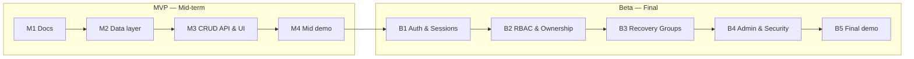

# Product Requirements Document (PRD) — Campus Lost & Found

| Field | Value |
|---|---|
| Product | Campus Lost & Found Management System |
| Version | MVP + Beta |
| Releases | MVP — Mid-term, Beta — Final |
| Status | Completed |
| Related docs | [Software Requirements Specification (SRS)](02-srs.md), [Technical Design Document (TDD)](03-tdd.md) |

This document covers **both releases**. Every goal, feature, and user story has a **Release** column showing what was built for the mid-term (**MVP**) and what was added for the final (**Beta**).

**Documents in this set**

| Short form | Full form | Purpose | File |
|---|---|---|---|
| PRD | Product Requirements Document | What we build and why (this document) | [01-prd.md](01-prd.md) |
| SRS | Software Requirements Specification | Exact requirements, permissions, and acceptance criteria | [02-srs.md](02-srs.md) |
| TDD | Technical Design Document | How we build it: architecture, data model, API, security | [03-tdd.md](03-tdd.md) |

## 0. Release plan

| Release | When | Focus |
|---|---|---|
| **MVP** | Mid-term | Core product: lost & found report CRUD REST API, React UI, database, deployed on Vercel |
| **Beta** | Final | Multi-user auth (JWT + refresh cookies), RBAC (`user` / `admin`), shared Recovery Teams (groups), admin dashboard, audit log, and security hardening |

## 1. Purpose

Campus Lost & Found is built in two clear steps so the documentation and working code stay in sync:

1. **MVP (mid-term):** A working **REST API and React UI for creating, viewing, filtering, updating, and deleting lost and found reports (CRUD)**, deployed on Vercel.
2. **Beta (final):** Turn the MVP into a secure multi-user application with accounts and login (JWT + refresh cookies), personal report ownership, role-based access control (RBAC), shared Recovery Teams (groups with per-member permissions), an admin moderation and audit dashboard, and security hardening.

## 2. Problem statement

Students and staff frequently lose ID cards, calculators, keys, chargers, and notebooks across campus. Posting in chat groups or asking building guards is unreliable because messages get buried, cannot be filtered by category or status, and offer no way to verify ownership.

In addition, campus lost-and-found desks (such as the Main Library desk) are run by teams of student volunteers. Each user's personal reports must stay private from other users, team leaders need control over what each volunteer can create, edit, or assign, and campus administrators need an audit trail and moderation tools to keep the platform safe in production.

## 3. Goals

| ID | Goal | Release |
|---|---|---|
| G-1 | Provide a REST API and React UI for lost and found report CRUD following standard REST conventions. | MVP |
| G-2 | Store reports in a database so data survives server restarts and redeploys. | MVP |
| G-3 | Document the API automatically with OpenAPI at `/api/docs`. | MVP |
| G-4 | Deploy automatically to Vercel on every push to `main`. | MVP |
| G-5 | Each user has an account and sees/modifies only their own personal reports. | Beta |
| G-6 | Control access with global roles (`user` and `admin`) through one reusable RBAC module. | Beta |
| G-7 | Let users collaborate in shared Recovery Teams (groups) with per-member permissions (`can_create`, `can_edit`, `can_assign`). | Beta |
| G-8 | Protect accounts and data with Pepper + Argon2 password hashing, short-lived JWTs, `HttpOnly` refresh cookies, login lockout, and audit logging. | Beta |

## 4. Target users

| User | Need | Release |
|---|---|---|
| Student / campus member | Report lost or found items, filter by category/type, and update item status (`active`, `claimed`, `resolved`). | MVP |
| Frontend developer | A clear, documented REST API (`/api/items`) to connect the React UI. | MVP |
| Instructor / reviewer | An easy way to test the live app, `/api/docs`, and demo accounts. | MVP |
| Registered user | Private personal report list behind login, profile page to update name/password, and device session manager. | Beta |
| Group owner | Create a shared Recovery Team, add/remove members by email, and choose each member's permissions (`create`, `edit`, `assign`). | Beta |
| Group member | View shared team reports and create, update, or assign items based on granted permissions. | Beta |
| Admin | View 7-day dashboard stats, search/inspect users, change roles, ban/unban users, moderate reports/groups, inspect audit & security logs, and export CSV files. | Beta |

In the **MVP** there are no accounts: all reports are on one shared board. In the **Beta** every report belongs either to a specific user (personal report) or to a shared Recovery Team (group report).

## 5. Scope

### In scope — MVP (mid-term)
- Create, list, filter (by type, category, status, and keyword), view, update, and delete lost/found reports
- Input validation and clear JSON error responses
- Health check endpoint (`GET /api/health`)
- Interactive API docs at `/api/docs`
- Automatic deployment to Vercel

### In scope — Beta (final)
- **Auth & Sessions:** Sign up, log in, log out, silent session refresh (15-min JWT access token + 7-day `HttpOnly` refresh cookie rotation), list active device sessions, and revoke individual or all sessions
- **User profile:** View profile, update display name, change password (verifying current password)
- **Personal reports:** Every personal report belongs to its creator (`owner_id`); normal users only see, edit, and delete their own reports
- **RBAC:** `user` and `admin` roles enforced on every endpoint via `backend/rbac.py`
- **Shared Recovery Teams (groups):** Create/rename/delete a group, add/remove members by email, assign per-member permissions (`can_create`, `can_edit`, `can_assign`), and assign a volunteer handler (`assignee_id`) to group items
- **Admin dashboard:** 7-day usage stats, user search/filters/pagination, user detail inspector (reports, groups, sessions, activity), role change, single & bulk ban/unban with reason, single & bulk report/group deletion, activity audit log, security view (failed logins by IP & account), and filter-aware CSV exports
- **Security hardening:** Pepper + Argon2 password hashing, 5-attempt / 15-minute brute-force login lockout (`429`), security headers, secrets in environment variables (only `.env.example` in git), and automated `pytest` tests

### Out of scope for this semester
- Image file uploads and external cloud blob storage
- Email verification, SMTP password reset emails, and social OAuth login
- Real-time WebSocket push notifications
- Transferring group ownership to another member

## 6. Features and priority (MoSCoW)

| ID | Feature | Release | Priority |
|---|---|---|---|
| F-1 | Create lost or found report | MVP | Must |
| F-2 | List and filter reports (type, category, status, search) | MVP | Must |
| F-3 | Get single report by ID | MVP | Must |
| F-4 | Update report fields and status (`active`, `claimed`, `resolved`) | MVP | Must |
| F-5 | Delete report | MVP | Must |
| F-6 | Input validation and consistent error responses | MVP | Must |
| F-7 | Health check (`GET /api/health`) and `/api/docs` | MVP | Must |
| F-8 | React frontend connected to FastAPI on Vercel | MVP | Must |
| F-9 | Sign up, log in, log out, and refresh session (`HttpOnly` cookie rotation) | Beta | Must |
| F-10 | Personal report ownership (private to owner; `403` for other users) | Beta | Must |
| F-11 | Global roles (`user` / `admin`) and reusable RBAC module (`backend/rbac.py`) | Beta | Must |
| F-12 | User profile: update name and change password (current password required) | Beta | Must |
| F-13 | Device sessions: list active sessions and revoke single, other, or all sessions | Beta | Should |
| F-14 | Shared Recovery Teams (groups): create, rename, delete, list groups | Beta | Must |
| F-15 | Group members: add by email, remove, and configure `can_create`, `can_edit`, `can_assign` | Beta | Must |
| F-16 | Group reports: shared team list, assign handler (`assignee_id`), owner-only delete | Beta | Must |
| F-17 | Admin dashboard: 7-day overview stats + paginated user list with search and filters | Beta | Must |
| F-18 | Admin user detail inspector (user's reports, groups, sessions, and recent activity) | Beta | Should |
| F-19 | Admin actions: ban/unban with reason, role change, revoke sessions, bulk ban/unban | Beta | Must |
| F-20 | Admin content moderation: filter all reports/groups, single and bulk delete | Beta | Must |
| F-21 | Activity audit log: record auth, password, role, ban, delete, RBAC denial, and export events with IP & browser | Beta | Must |
| F-22 | Security monitor (failed logins by IP & account) and filter-aware CSV exports | Beta | Should |
| F-23 | Security hardening (Pepper + Argon2, 5-attempt lockout, security headers, `pytest` suite) | Beta | Must |

## 7. User stories

### MVP

| ID | Story | Feature |
|---|---|---|
| US-01 | As a campus member, I want to create a lost or found report with title, category, location, and contact info, so that the item can be recovered. | F-1 |
| US-02 | As a campus member, I want to browse and filter reports by type, category, and keyword, so I can quickly find a matching item. | F-2 |
| US-03 | As a campus member, I want to open a report's detail modal, so I can read its full description and contact info. | F-3 |
| US-04 | As a campus member, I want to edit a report or mark it `claimed` / `resolved`, so the board stays accurate. | F-4 |
| US-05 | As a campus member, I want to delete an obsolete report, so the list stays clean. | F-5 |
| US-06 | As a developer/tester, I want clear validation errors and `/api/health`, so I can verify the deployment is healthy. | F-6, F-7 |

### Beta

| ID | Story | Feature |
|---|---|---|
| US-07 | As a visitor, I want to sign up with my name, campus email, and password, so I get my own account. | F-9 |
| US-08 | As a user, I want to log in, have my 15-minute token refresh automatically, and log out cleanly, so my session stays secure. | F-9 |
| US-09 | As a user, I want to see and modify only my own personal reports (`403` for others), so my reports cannot be altered by strangers. | F-10 |
| US-10 | As a user, I want to update my name and change my password by confirming my current password, so I can keep my account safe. | F-12 |
| US-11 | As a user, I want to see all devices where I am logged in and revoke any session, so I can secure my account on shared lab PCs. | F-13 |
| US-12 | As a user, I want to create a shared Recovery Team (e.g., *Main Library Lost & Found Team*), so our desk volunteers can share one item list. | F-14 |
| US-13 | As a group owner, I want to add or remove members by email and choose whether each member can create, edit, or assign items (while only I can delete or rename), so the team desk stays controlled. | F-15, F-16 |
| US-14 | As a group member, I want to log found items and assign a volunteer handler according to my granted permissions, so our team tracks who handles each return. | F-16 |
| US-15 | As a user, I want passwords hashed with Pepper + Argon2 and 5 wrong logins locked for 15 minutes (`429`), so brute-force attacks are stopped. | F-23 |
| US-16 | As an admin, I want an overview dashboard with total users, banned users, reports, groups, and 7-day new counts, so I can monitor campus activity. | F-17 |
| US-17 | As an admin, I want to search/filter users, open a user's detail drawer (reports, groups, sessions, activity), and change their role or revoke their sessions. | F-17, F-18, F-19 |
| US-18 | As an admin, I want to ban or unban users (individually or in bulk) with a reason so banned users are blocked on their very next request (`403`). | F-19 |
| US-19 | As an admin, I want to filter all reports and groups and delete spam items singly or in bulk, so the platform stays clean. | F-20 |
| US-20 | As an admin, I want to search the activity audit log, check failed logins by IP and account in the Security Monitor, and export filtered CSV files. | F-21, F-22 |

## 8. Success metrics

### MVP
- All five report CRUD endpoints work on the live Vercel URL.
- Data persists in the database across requests.
- `/api/docs` lists all endpoints and schemas cleanly.

### Beta
- A normal user can never read, edit, or delete another user's personal report (`403 Forbidden`).
- Every endpoint enforces the RBAC permission matrix in [SRS, section 3.9](02-srs.md#39-permission-matrix--beta).
- Group members can only perform actions enabled on their membership (`can_create`, `can_edit`, `can_assign`), and only the owner can delete items, rename/delete the group, or manage members.
- Passwords are never stored or returned in plain text (Pepper + Argon2).
- A banned user is rejected with `403` on their very next request, even if their JWT has not expired yet.
- All 7 automated `pytest` tests in `backend/tests/test_auth_and_rbac.py` pass 100%.

## 9. Assumptions and constraints

- Hosted on Vercel (React frontend and FastAPI backend in one monorepo project via `vercel.json`).
- Vercel functions are serverless, so production data lives in a hosted PostgreSQL database (`DATABASE_URL`), while local development uses SQLite.
- Backend: Python 3.10+ with FastAPI and SQLModel. Frontend: Vite + React + TypeScript.
- On startup, `seed_initial_data()` automatically seeds the required instructor demo accounts (2 Admins and 3 Normal Users), sample reports, and 1 shared group with mixed permissions.

## 10. Milestones

### MVP — Mid-term

| Milestone | Deliverable |
|---|---|
| M1 — Docs | [PRD](01-prd.md), [SRS](02-srs.md), and [TDD](03-tdd.md) approved |
| M2 — Data layer | `Item` SQLModel table and database connection |
| M3 — CRUD API & UI | Five `/api/items` CRUD endpoints with validation and React board UI |
| M4 — Mid demo | Live on Vercel |

### Beta — Final

| Milestone | Deliverable |
|---|---|
| B1 — Auth & Sessions | Signup, login, logout, refresh token rotation, device sessions, profile name & password update |
| B2 — RBAC & Ownership | `backend/rbac.py`, `user` / `admin` roles, personal report ownership scoping, `ProtectedRoute.tsx` |
| B3 — Recovery Groups | Shared groups (`/api/groups`), member management by email, `can_create` / `can_edit` / `can_assign` flags, item assignee |
| B4 — Admin & Security | 4-tab Admin Dashboard, single/bulk ban & delete, activity audit log, security monitor, CSV exports, Pepper + Argon2, 5-try lockout, `pytest` suite |
| B5 — Final demo | Beta live on Vercel with `docs/FINAL_REPORT.md` |

## 11. Release dependencies

- The Beta builds directly on top of the MVP: the `/api/items` endpoints remain, but in the Beta they require a valid JWT and return only the caller's own personal reports (or group reports for authorized group members).
- Lightweight schema upgrades in `database.py` (`create_db_and_tables`) automatically add new Beta columns and tables (`campus_user`, `campus_session`, `campus_group`, `campus_group_member`, `campus_activity_log`) without breaking existing data.
