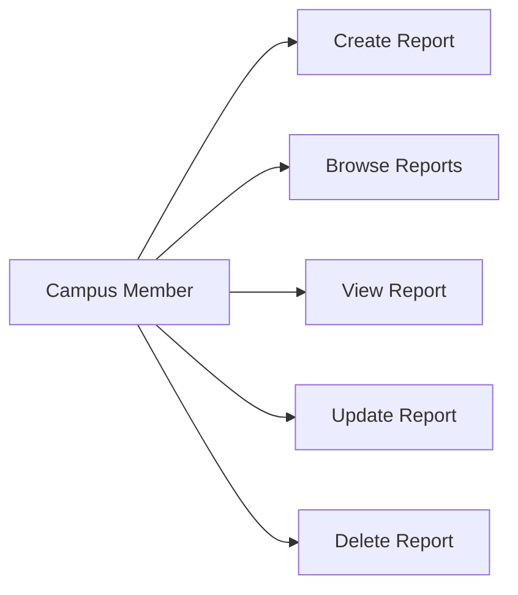
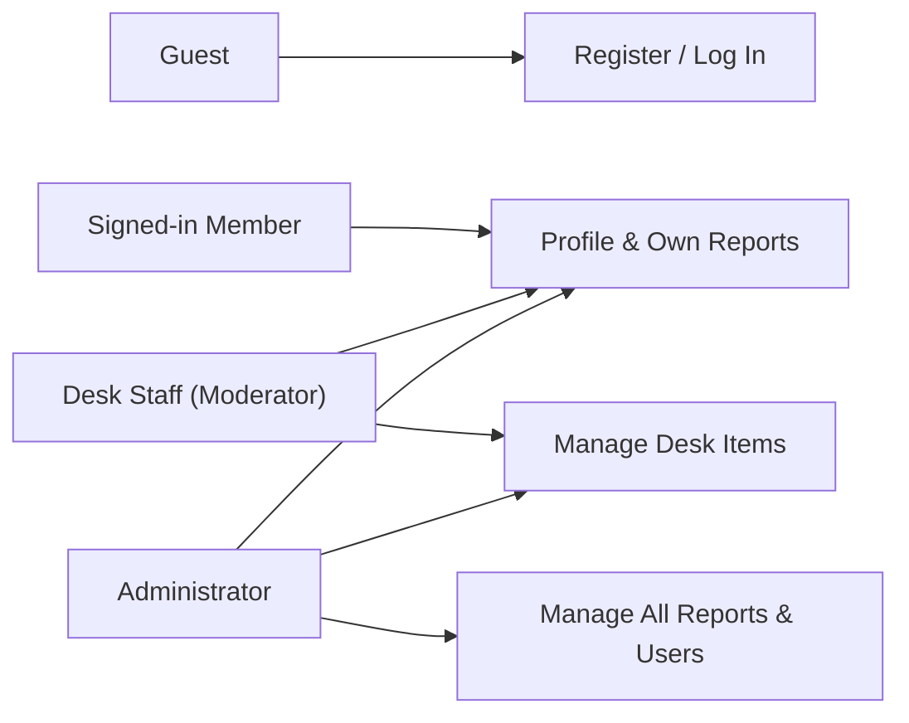

# Software Requirements Specification (SRS)
## Campus Lost & Found Management System

| **Field** | **Details** |
|---|---|
| Product | Campus Lost & Found Management System |
| Releases | MVP (Mid-term) and Beta (Final) |
| Status | Complete (Beta Released) |
| Related Documents | [PRD](01-prd.md), [TDD](03-tdd.md) |

---

## 1. Introduction

### 1.1 Purpose

This document defines the software requirements for the Campus Lost & Found application. It describes the functional and non-functional requirements for both the MVP and Beta releases.

### 1.2 Scope

The application is developed in two releases:

- **MVP (Mid-term):** Users can create, view, update, and delete lost-and-found reports through a REST API. The application runs locally without requiring user authentication.
- **Beta (Final):** The application introduces JWT user authentication (access & rotating refresh tokens), token revocation on logout, account lockout after failed login attempts, user/moderator/admin roles, item ownership rules, campus team desks, and deployment on Vercel.

### 1.3 Definitions

| **Term** | **Meaning** |
|---|---|
| Report | A record describing a lost or found item. |
| CRUD | Create, Read, Update, and Delete operations. |
| REST API | An interface allowing frontend and backend communication via HTTP requests. |
| JWT | JSON Web Token used for secure, stateless user authentication. |
| Access Token | Short-lived JWT (15 min) used to authenticate API requests. |
| Refresh Token | Longer-lived token (7 days) used to obtain a new access token without logging in again. |
| Token Revocation | Invalidation of a token upon logout so it cannot be reused. |
| RBAC | Role-Based Access Control: permissions depend on the user's assigned role. |
| Scope | A specific permission checked by the API before allowing an operation. |
| MVP | Minimum Viable Product: the initial working version of the application. |
| Beta | The enhanced version of the application prepared for the final release. |

---

## 2. Users and Roles

| **User / Role** | **Release** | **Description** |
|---|---|---|
| Local User / Guest | MVP | Uses the application without signing in (view reports only in Beta). |
| Registered Member (`user`) | Beta | Signs in, manages personal profile, and creates/edits/deletes own reports. |
| Campus Staff (`moderator`) | Beta | Manages items assigned to campus team desks (Security, Library, IT). |
| Administrator (`admin`) | Beta | Has full permissions to manage all reports, users, roles, and view analytics. |

---

## 3. Functional Requirements

### 3.1 Report Management — MVP

| **ID** | **Requirement** | **Release** |
|---|---|---|
| FR-01 | The system shall allow users to create a lost or found report containing a title, description, category, and location. | MVP |
| FR-02 | The system shall display a list of reports and allow users to view individual reports by ID. | MVP |
| FR-03 | The system shall allow users to update and delete existing reports. | MVP |
| FR-04 | The API shall validate report data and return clear error messages for invalid input or missing reports. | MVP |
| FR-05 | Users shall be able to create, view, update, and delete reports through the React frontend integrated with the FastAPI REST API. | MVP |
| FR-06 | The application shall run locally without requiring user accounts or authentication. | MVP |

### 3.2 Authentication, RBAC, and Security — Beta

| **ID** | **Requirement** | **Release** |
|---|---|---|
| FR-07 | Users shall be able to register, log in, and log out of the application. | Beta |
| FR-08 | The system shall provide a profile dashboard for authenticated users to view info and update passwords. | Beta |
| FR-09 | The system shall support `user`, `moderator`, and `admin` roles. Public registration shall default to `user` role and never grant admin privileges. | Beta |
| FR-10 | The API shall enforce user roles, security scopes, and report ownership when performing protected actions. | Beta |
| FR-11 | The API shall reject requests with missing or invalid authentication using HTTP `401` and requests with insufficient permissions using HTTP `403`. | Beta |
| FR-12 | The application shall be deployed and accessible live over HTTPS for the final demonstration. | Beta |
| FR-13 | The system shall issue short-lived JWT access tokens (15 minutes) and rotating refresh tokens (7 days). | Beta |
| FR-14 | The system shall revoke tokens on logout so that invalidated tokens cannot be reused. | Beta |
| FR-15 | The system shall temporarily lock an account for 15 minutes after 5 consecutive failed login attempts. | Beta |
| FR-16 | The system shall enforce ownership permissions so regular users can only edit and delete their own reports. | Beta |
| FR-17 | The system shall support Campus Team Desks (`Security Desk`, `Library Front Desk`, `IT Helpdesk`) for staff collaboration. | Beta |

---

## 4. Non-Functional Requirements

| **ID** | **Requirement** | **Release** |
|---|---|---|
| NFR-01 | The frontend shall be developed using React with TypeScript, and the backend shall use FastAPI with Python. | MVP |
| NFR-02 | The frontend and backend shall communicate through JSON-based REST APIs. | MVP |
| NFR-03 | Invalid data and failed requests shall return clear error messages and shall not be presented as successful operations. | MVP |
| NFR-04 | User passwords shall be securely hashed using Argon2 or PBKDF2; sensitive secrets shall not be committed to the repository. | Beta |
| NFR-05 | Authorization and permission checks shall be enforced by the backend rather than relying only on frontend controls. | Beta |
| NFR-06 | The deployed application shall use HTTPS to secure communication between clients and the server. | Beta |
| NFR-07 | JWT tokens shall be cryptographically signed using HMAC-SHA256 with an untracked secret key. | Beta |

---

## 5. Acceptance Criteria

### 5.1 MVP Acceptance Criteria

The MVP was accepted when:

- The application starts and runs successfully in a local environment.
- Users can create, list, view, update, and delete lost-and-found reports.
- Invalid report data is rejected with appropriate API error messages.
- The React frontend successfully communicates with the FastAPI REST endpoints.
- Report information is stored and retrieved correctly from the local database.

### 5.2 Beta Acceptance Criteria

The Beta release is accepted when:

- Users can register, log in, refresh tokens, and access their profile dashboard.
- 5 consecutive failed login attempts lock the account for 15 minutes.
- Regular members cannot edit or delete reports created by other users.
- Regular members cannot access administrator or moderator endpoints.
- Desk staff (`moderator`) can manage reports assigned to campus desks.
- Administrators can manage all reports, users, roles, and team desks.
- All 7 automated security and RBAC tests pass (100%).
- The application is deployed and accessible over HTTPS on Vercel.

---

## 6. Use Cases

### 6.1 MVP Use Cases

---

### 6.2 Beta Use Cases

**Description:**

- **Guest:** Can browse public reports and register or log in.
- **Signed-in Member (`user`):** Can manage own profile, create reports, and edit/delete own reports.
- **Desk Staff (`moderator`):** Can manage items assigned to campus team desks (Security, Library, IT).
- **Administrator (`admin`):** Full control over all reports, user roles, accounts, and system analytics.

---

**End of Software Requirements Specification (SRS)**
