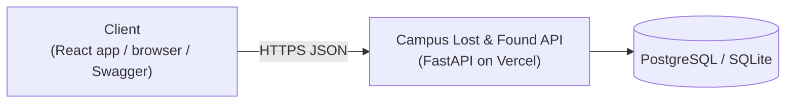
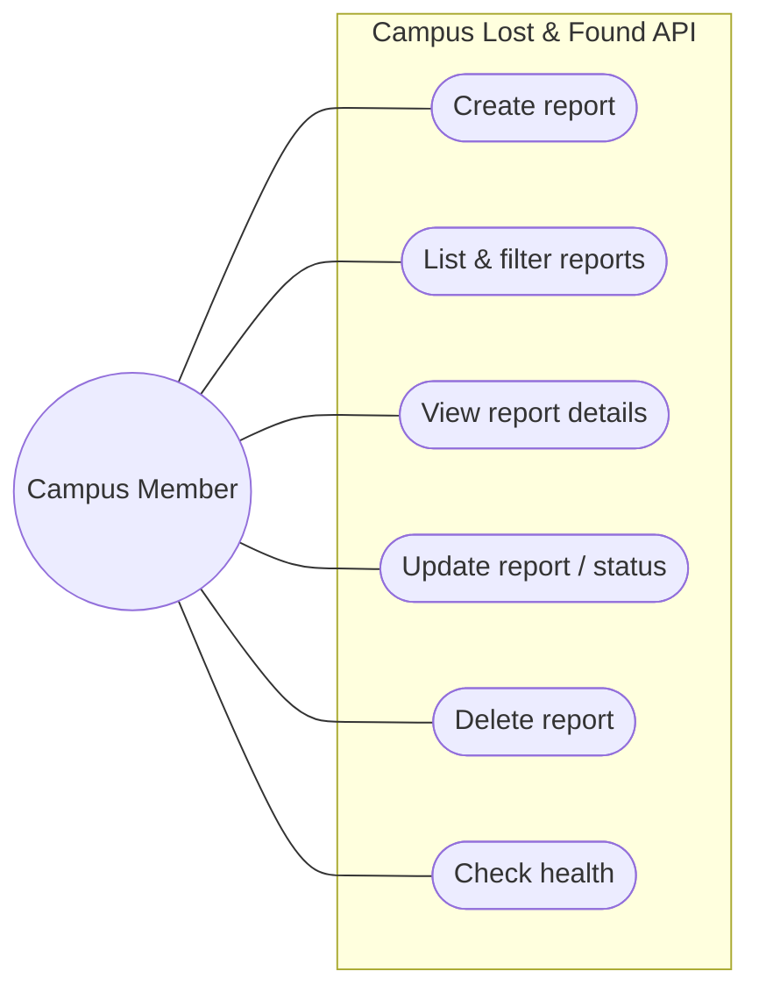
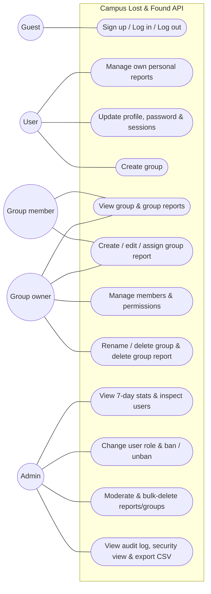
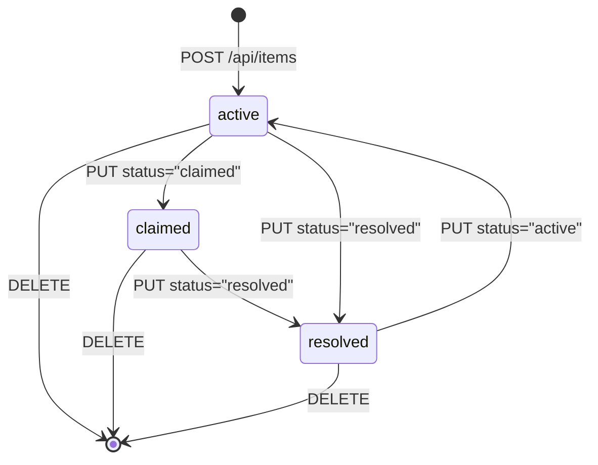

# Software Requirements Specification (SRS) — Campus Lost & Found

| Field | Value |
|---|---|
| Product | Campus Lost & Found Management System |
| Version | MVP + Beta |
| Releases | MVP — Mid-term, Beta — Final |
| Status | Completed |
| Related docs | [Product Requirements Document (PRD)](01-prd.md), [Technical Design Document (TDD)](03-tdd.md) |

Every requirement has a **Release** column: **MVP** was built for the mid-term, and **Beta** was added for the final.

**Documents in this set**

| Short form | Full form | Purpose | File |
|---|---|---|---|
| PRD | Product Requirements Document | What we build and why | [01-prd.md](01-prd.md) |
| SRS | Software Requirements Specification | Exact requirements, permissions, and acceptance criteria (this document) | [02-srs.md](02-srs.md) |
| TDD | Technical Design Document | How we build it: architecture, data model, API, security | [03-tdd.md](03-tdd.md) |

## 1. Introduction

### 1.1 Purpose
This document lists the requirements for Campus Lost & Found: the MVP (lost and found report CRUD REST API and React board) and the Beta (accounts, JWT sessions, RBAC, shared Recovery Teams, admin dashboard, audit log, and security hardening), deployed on Vercel.

### 1.2 Scope
- **MVP:** A client can create, list, filter, view, update, and delete lost/found reports over HTTP. There are no accounts; all reports are on one shared list.
- **Beta:** Users sign up and log in, see and change only their own personal reports, collaborate in shared Recovery Teams (groups) with per-member permissions, and admins manage users, content, audit logs, and CSV exports.
- Out of scope: see [PRD, section 5](01-prd.md#5-scope).

### 1.3 Definitions

| Term | Meaning |
|---|---|
| CRUD | Create, Read, Update, Delete |
| REST | API style where resources (like `/api/items`) are accessed with HTTP methods (`GET`, `POST`, `PUT`, `PATCH`, `DELETE`) |
| Report (`Item`) | A lost or found item record with `type`, `title`, `category`, `location`, `description`, `contact_info`, and `status` |
| Personal report | (Beta) A report that belongs to one user (`owner_id`) and is visible/editable only by that user (and admins) |
| Group (`DeskGroup`) | (Beta) A shared Recovery Team (e.g., *Main Library Lost & Found Team*) with members and shared reports |
| Group report | (Beta) A report linked to a `group_id` and visible to all members of that group |
| RBAC | Role-Based Access Control: what a caller can do depends on their role (`user` / `admin`) and group permissions |
| JWT | JSON Web Token: a signed HS256 token proving who the caller is (`sub`, `email`, `role`, `iat`, `exp`) |
| Access token | (Beta) Short-lived JWT (`<= 15 minutes`) sent in the `Authorization: Bearer` header |
| Refresh token | (Beta) 7-day random token in an `HttpOnly` cookie, stored as a SHA-256 hash in `campus_session` |
| OpenAPI | Interactive API documentation generated by FastAPI at `/api/docs` |

## 2. Overall description

### 2.1 System context

### 2.2 Users and roles

| Role | Release | Description |
|---|---|---|
| Anonymous client | MVP | Anyone reaching the API; full access to the shared report board in MVP |
| Guest (Visitor) | Beta | Not logged in; can only sign up, log in, check `/api/health`, and open `/api/docs` |
| User (`user`) | Beta | Logged in; manages their own personal reports, profile, password, sessions, and can create/join groups |
|Group owner (`owner`) | Beta | Per-group role of the user who created the group: rename/delete group, add/remove members, set member permissions, delete group items |
| Group member (`member`) | Beta | Per-group role: view group items and create, edit, or assign items if granted (`can_create`, `can_edit`, `can_assign`) |
| Admin (`admin`) | Beta | System moderator: view 7-day stats, search/inspect users, change roles, ban/unban users, delete any report/group, view audit & security logs, export CSVs |

`user` and `admin` are **global** roles stored on `campus_user`. `owner` and `member` are **per-group** roles stored on `campus_group_member`.

### 2.3 Use cases

**MVP**

**Beta**

### 2.4 Constraints
- C-1: Runs on Vercel serverless functions (`vercel.json` routes `/api/*` to FastAPI and `/*` to React).
- C-2: Backend uses Python 3.10+ with FastAPI and SQLModel; frontend uses React + TypeScript + Vite.
- C-3: All API endpoints start with `/api` and exchange JSON (except CSV export downloads).
- C-4: Production uses a hosted PostgreSQL database (`DATABASE_URL`); local development uses SQLite.
- C-5: Authentication and RBAC are built directly in FastAPI without third-party auth services.

### 2.5 Assumptions
- A-1: `DATABASE_URL`, `JWT_SECRET`, and `PASSWORD_PEPPER` are set in Vercel Environment Variables.
- A-2: Startup seeding (`seed_initial_data`) ensures the 2 demo admins, 3 demo normal users, sample reports, and 1 shared group with mixed permissions exist automatically.

## 3. Functional requirements

### 3.1 Reports — MVP

| ID | Requirement | Release | Story |
|---|---|---|---|
| FR-01 | The system shall create a lost or found report (`POST /api/items`) with `type` (`lost`/`found`), `title`, `category`, `location`, `description`, `contact_info`, and `status` (default `active`). | MVP | US-01 |
| FR-02 | The system shall list reports (`GET /api/items`), newest first, with optional filters for `type`, `category`, `status`, and keyword `search`. | MVP | US-02 |
| FR-03 | The system shall return a single report by ID (`GET /api/items/{id}`). | MVP | US-03 |
| FR-04 | The system shall update report fields or status (`active`, `claimed`, `resolved`) via `PUT /api/items/{id}`. | MVP | US-04 |
| FR-05 | The system shall delete a report by ID (`DELETE /api/items/{id}`). | MVP | US-05 |
| FR-06 | The system shall reject invalid input with status `422` and return `404` when a report ID does not exist. | MVP | US-06 |
| FR-07 | The system shall expose `GET /api/health` returning `{"status": "ok"}` and publish OpenAPI docs at `/api/docs`. | MVP | US-06 |

### 3.2 Authentication, profile, and sessions — Beta

| ID | Requirement | Release | Story |
|---|---|---|---|
| FR-08 | The system shall let a guest sign up (`POST /api/auth/register`) with `name`, `email`, and `password` (`>= 6` chars). Duplicate emails return `409`. New accounts get role `user`. | Beta | US-07 |
| FR-09 | The system shall mix every password with `PASSWORD_PEPPER` (HMAC-SHA256) before hashing with Argon2, and never store or return plain passwords. | Beta | US-15 |
| FR-10 | The system shall authenticate users (`POST /api/auth/login`) and return a signed HS256 JWT access token (`<= 15 minutes`, containing `sub`, `email`, `role`, `iat`, `exp`) plus an `HttpOnly` `refresh_token` cookie. Wrong email or password returns `401`. | Beta | US-08 |
| FR-11 | The system shall verify the JWT on every protected request and return `401` if it is missing, malformed, tampered, or expired. | Beta | US-08 |
| FR-12 | The system shall store only the SHA-256 hash of refresh tokens in `campus_session`, rotate the token hash on `POST /api/auth/refresh`, and revoke the session on `POST /api/auth/logout`. | Beta | US-08 |
| FR-13 | The system shall allow a user to update their display name (`PUT /api/profile`) and change their password (`POST /api/profile/password`) after verifying their current password (`400` if wrong, revoking active refresh sessions on success). | Beta | US-10 |
| FR-14 | The system shall allow a user to list their active device sessions (`GET /api/auth/sessions`) with IP and browser User-Agent, and revoke one, all other, or all sessions. | Beta | US-11 |

### 3.3 Personal reports — Beta

| ID | Requirement | Release | Story |
|---|---|---|---|
| FR-15 | In the Beta, `GET /api/items` shall return only the signed-in user's own personal reports (`owner_id == current_user.id` and `group_id == None`). | Beta | US-09 |
| FR-16 | Reading, updating, or deleting another user's personal report (`GET/PUT/DELETE /api/items/{id}`) shall return `403 Forbidden` and log `rbac_denied` (unless the caller is an `admin`). | Beta | US-09 |

### 3.4 Roles (RBAC) and admin dashboard — Beta

| ID | Requirement | Release | Story |
|---|---|---|---|
| FR-17 | Every user shall have a global role (`user` or `admin`) enforced on the server through one reusable module (`backend/rbac.py`). Non-admins calling `/api/admin/*` receive `403`. | Beta | US-16 |
| FR-18 | An admin shall view dashboard stats (`GET /api/admin/stats`): total users, admins, banned users, new users in last 7 days, total/lost/found/claimed reports, new reports in last 7 days, and total groups. | Beta | US-16 |
| FR-19 | An admin shall list users (`GET /api/admin/users`) with pagination (`offset`, `limit`), search (`name`/`email`), role filter, and status filter (`active`/`banned`), and inspect a user's detail view (`GET /api/admin/users/{id}`) showing reports, groups, sessions, and recent activity. | Beta | US-17 |
| FR-20 | An admin shall change another user's role (`PATCH /api/admin/users/{id}/role`). Changing their own role returns `400`. | Beta | US-17 |
| FR-21 | An admin shall ban a user with a reason (`POST /api/admin/users/{id}/ban`), which sets `is_banned = True` and revokes all their sessions, or unban them (`/unban`). Banning oneself or another admin returns `400`. | Beta | US-18 |
| FR-22 | A banned user shall receive `403 ("Account banned")` on login and on their very next authenticated request, even if their 15-minute JWT has not expired yet. | Beta | US-18 |
| FR-23 | An admin shall execute bulk ban, bulk unban, and bulk report delete operations (up to 50 IDs per call), returning `affected` and `skipped` counts. | Beta | US-18, US-19 |
| FR-24 | An admin shall list and filter all reports (`GET /api/admin/items`) and groups (`GET /api/admin/groups`), and delete any report or group. | Beta | US-19 |
| FR-25 | The system shall record auth, password, role, ban, report/group delete, export, token rejection, and RBAC denial events in `campus_activity_log` with user email, IP address, browser User-Agent, and UTC time, searchable and filterable via `GET /api/admin/activity`. | Beta | US-20 |
| FR-26 | An admin shall view a security report (`GET /api/admin/security`) grouping failed logins by IP address and by account, plus recent security events (`token_rejected`, `rbac_denied`, `failed_login`). | Beta | US-20 |
| FR-27 | An admin shall export filtered users, reports, and activity logs as CSV files (`/api/admin/export/users`, `items`, `activity`). | Beta | US-20 |

### 3.5 Groups (Recovery Teams) and group permissions — Beta

| ID | Requirement | Release | Story |
|---|---|---|---|
| FR-28 | Any authenticated user shall create a shared Recovery Group (`POST /api/groups`) and become its `owner`, and list groups they belong to (`GET /api/groups`). | Beta | US-12 |
| FR-29 | The group owner shall add members by email (`POST /api/groups/{id}/members`), remove members, and update each member's boolean permissions (`can_create`, `can_edit`, `can_assign`) via `PATCH /api/groups/{id}/members/{uid}`. | Beta | US-13 |
| FR-30 | Group members shall view group reports (`GET /api/groups/{id}/items`) and may create (`POST /api/groups/{id}/items`), edit (`PUT /api/items/{id}`), or assign (`assignee_id`, which must be a group member or returns `422`) only if their corresponding permission flag is `True` (`403` otherwise). | Beta | US-13, US-14 |
| FR-31 | Only the group `owner` (or system `admin`) may delete a group report, rename/delete the group (`PATCH/DELETE /api/groups/{id}`), or manage members (`403` for regular members). | Beta | US-13 |

### 3.6 Account security — Beta

| ID | Requirement | Release | Story |
|---|---|---|---|
| FR-32 | After 5 consecutive failed logins for an account, the system shall lock the account for 15 minutes and return `429 Too Many Requests`. A successful login or admin unban resets the counter. | Beta | US-15 |

### 3.7 Validation rules

| Field | Rule | Release |
|---|---|---|
| `type` | Required on report create: `'lost'` or `'found'` | MVP |
| `title` | Required, non-empty string (1–150 characters after trimming) | MVP |
| `category` / `location` | Required non-empty strings | MVP |
| `status` | `'active'`, `'claimed'`, or `'resolved'` | MVP |
| `email` | Valid email address, stored lowercase and trimmed | Beta |
| `name` (user / group) | Non-empty string, 1–100 characters | Beta |
| `password` | Minimum 6 characters | Beta |
| `role` | `'user'` or `'admin'` | Beta |
| `assignee_id` | Optional integer; must be a member of the report's group (`422` otherwise) | Beta |
| `offset` / `limit` | `offset >= 0`, `1 <= limit <= 100` | Beta |

### 3.8 Report states

### 3.9 Permission matrix — Beta

| Action | Guest | User | Group member | Group owner | Admin |
|---|---|---|---|---|---|
| Sign up, log in, check `/api/health` | Yes | Yes | Yes | Yes | Yes |
| Log out, update own profile, change password, manage own sessions | No (`401`) | Yes | Yes | Yes | Yes |
| CRUD own personal reports | No (`401`) | Yes | Yes | Yes | Yes |
| Read, update, or delete another user's personal report | No (`401`) | No (`403`) | No (`403`) | No (`403`) | Yes |
| Create a Recovery Group | No (`401`) | Yes | Yes | Yes | Yes |
| View group reports & members | No (`401`) | No (`403`) | Yes | Yes | Yes |
| Create / edit / assign group reports | No (`401`) | No (`403`) | **If granted flag (`403` otherwise)** | Yes | Yes |
| Delete group report, rename/delete group, manage members & flags | No (`401`) | No (`403`) | No (`403`) | **Yes (Owner)** | Yes |
| View admin stats, list/inspect users, change roles, ban/unban | No (`401`) | No (`403`) | No (`403`) | No (`403`) | **Yes (not self / other admin)** |
| View activity log, security monitor, bulk actions, CSV exports | No (`401`) | No (`403`) | No (`403`) | No (`403`) | **Yes** |

### 3.10 Status codes

| Case | Code | Release |
|---|---|---|
| Resource created | `201 Created` | MVP |
| Read, update, or delete succeeded | `200 OK` | MVP |
| Validation failed (missing/invalid field, non-member assignee) | `422 Unprocessable Entity` | MVP |
| Resource ID not found | `404 Not Found` | MVP |
| Unexpected server error (stack trace hidden) | `500 Internal Server Error` | MVP |
| Bad request (wrong current password, admin changing own role or banning admin) | `400 Bad Request` | Beta |
| Missing, malformed, tampered, or expired token; wrong email/password | `401 Unauthorized` | Beta |
| Authenticated but lacking role, ownership, or group flag; or account banned | `403 Forbidden` | Beta |
| Duplicate email on signup or existing group member | `409 Conflict` | Beta |
| Account locked after 5 failed login attempts | `429 Too Many Requests` | Beta |

## 4. Non-functional requirements

| ID | Category | Requirement | Release |
|---|---|---|---|
| NFR-01 | Performance | API endpoints respond in under 500 ms (excluding cold start). | MVP |
| NFR-02 | Persistence | Data is stored in a relational database and survives restarts. | MVP |
| NFR-03 | Availability | Production frontend and API are live on Vercel over HTTPS. | MVP |
| NFR-04 | Security | Database queries use parameterized SQLModel expressions, never string-built SQL. | MVP |
| NFR-05 | Security | Unhandled `500` errors return `{"detail": "Internal server error"}` without stack traces. | MVP |
| NFR-06 | Usability | Every endpoint is documented in `/api/docs`, and the React UI provides loading, empty, and error states. | MVP |
| NFR-07 | Security | Passwords are mixed with `PASSWORD_PEPPER` (from env vars) and hashed with Argon2; plain passwords are never stored or returned. | Beta |
| NFR-08 | Security | Access tokens are HS256 JWTs signed with `JWT_SECRET` from env vars and expire in `<= 15 minutes`. | Beta |
| NFR-09 | Security | Refresh tokens are valid for 7 days, sent in `HttpOnly` cookies, stored as SHA-256 hashes, and rotated on refresh. | Beta |
| NFR-10 | Security | Responses include `X-Content-Type-Options: nosniff`, `X-Frame-Options: DENY`, and `Referrer-Policy`, and CORS is restricted to `FRONTEND_ORIGIN`. | Beta |
| NFR-11 | Maintainability | All RBAC rules live in `backend/rbac.py` and 7 automated `pytest` tests verify login, lockout, token rejection, and RBAC. | Beta |

## 5. Acceptance criteria

### MVP

**AC-01 Create report (FR-01)**
- Given a valid report payload with `type`, `title`, `category`, `location`, `description`, and `contact_info`
- When the client sends `POST /api/items`
- Then the response is `201 Created` with the created report and `status: "active"`.

**AC-02 Reject invalid report (FR-06)**
- Given a payload with an empty `title` or invalid `type`
- When the client sends `POST /api/items`
- Then the response is `422 Unprocessable Entity`.

**AC-03 Update and delete report (FR-04, FR-05)**
- Given report `{id}` exists
- When the owner sends `PUT /api/items/{id}` with `{"status": "claimed"}`, the response is `200` with `status: "claimed"`.
- When the owner sends `DELETE /api/items/{id}`, the response is `200` and a subsequent `GET /api/items/{id}` returns `404`.

### Beta

**AC-04 Sign up & duplicate email (FR-08, FR-09)**
- When a guest signs up with a new email, the response is `201` with role `user` and no password hash returned.
- When someone signs up again with the same email, the response is `409 Conflict`.

**AC-05 Login, refresh & logout (FR-10, FR-12)**
- When a user logs in with valid credentials, the response is `200` with `access_token` (`expires_in <= 900`) and an `HttpOnly` `refresh_token` cookie.
- When `POST /api/auth/refresh` is called, the refresh token hash rotates and a new `access_token` is returned (`200`).
- After `POST /api/auth/logout`, calling `POST /api/auth/refresh` returns `401`.

**AC-06 Token rejection (FR-11)**
- When a client calls `GET /api/profile` with a missing token, malformed header, tampered signature, or expired JWT
- Then the server returns `401 Unauthorized` and logs `token_rejected`.

**AC-07 Login lockout (FR-32)**
- Given 5 consecutive wrong password attempts for an account
- When a 5th or subsequent login attempt is made within 15 minutes (even with the right password)
- Then the response is `429 Too Many Requests`.

**AC-08 Personal report ownership (FR-15, FR-16)**
- Given `student@campus.edu` created personal report `{id}`
- When `ammar@campus.edu` calls `GET`, `PUT`, or `DELETE /api/items/{id}`
- Then the server returns `403 Forbidden` and logs `rbac_denied`.

**AC-09 Shared group permissions (FR-29, FR-30, FR-31)**
- Given *Main Library Lost & Found Team* owned by `student@campus.edu`, where `ammar@campus.edu` has `can_create, can_edit, can_assign` and `sajid@campus.edu` has `can_create` only:
- When Sajid creates a group report (`POST /api/groups/{id}/items`), it succeeds (`201`).
- When Sajid tries to edit that report (`PUT /api/items/{item_id}`), it returns `403`.
- When Ammar edits that report, it succeeds (`200`), but when Ammar tries to delete it or rename the group, it returns `403` (owner-only).

**AC-10 Admin safety and immediate ban (FR-20, FR-21, FR-22)**
- When an admin tries to change their own role or ban another admin (`moderator@campus.edu`), the response is `400 Bad Request`.
- When an admin bans `sajid@campus.edu`, Sajid's very next API call with his existing JWT returns `403 Forbidden ("Account banned")`.

## 6. Traceability

| Story | Requirements | Endpoint (see [TDD, section 6](03-tdd.md#6-rest-api-design)) | Release |
|---|---|---|---|
| US-01 | FR-01 | `POST /api/items` | MVP |
| US-02 | FR-02 | `GET /api/items` | MVP |
| US-03 | FR-03 | `GET /api/items/{id}` | MVP |
| US-04 | FR-04 | `PUT /api/items/{id}` | MVP |
| US-05 | FR-05 | `DELETE /api/items/{id}` | MVP |
| US-06 | FR-06, FR-07 | `GET /api/health`, `/api/docs` | MVP |
| US-07 | FR-08, FR-09 | `POST /api/auth/register` | Beta |
| US-08 | FR-10 – FR-12 | `POST /api/auth/login`, `/refresh`, `/logout` | Beta |
| US-09 | FR-15, FR-16 | `GET/PUT/DELETE /api/items/*` | Beta |
| US-10 | FR-13 | `GET/PUT /api/profile`, `POST /api/profile/password` | Beta |
| US-11 | FR-14 | `GET/DELETE /api/auth/sessions/*` | Beta |
| US-12 | FR-28 | `GET/POST /api/groups` | Beta |
| US-13, US-14 | FR-29 – FR-31 | `/api/groups/{id}/*`, `/api/groups/{id}/members/{uid}`, `/api/groups/{id}/items` | Beta |
| US-15 | FR-09, FR-32 | `POST /api/auth/login` | Beta |
| US-16, US-17 | FR-17 – FR-20 | `GET /api/admin/stats`, `/users`, `/users/{id}`, `PATCH .../role` | Beta |
| US-18 | FR-21 – FR-23 | `POST /api/admin/users/{id}/ban`, `/unban`, `/bulk-ban`, `/bulk-unban` | Beta |
| US-19 | FR-23, FR-24 | `GET /api/admin/items`, `POST /api/admin/items/bulk-delete`, `/api/admin/groups` | Beta |
| US-20 | FR-25 – FR-27 | `GET /api/admin/activity`, `/security`, `/export/users`, `/export/items`, `/export/activity` | Beta |
