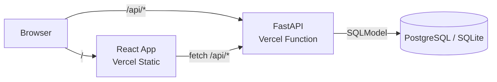
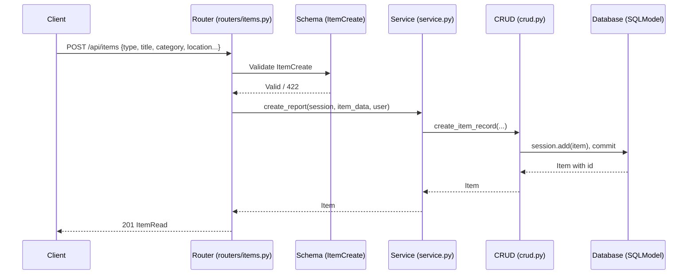
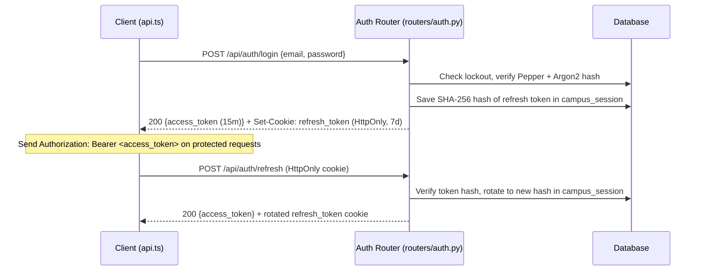
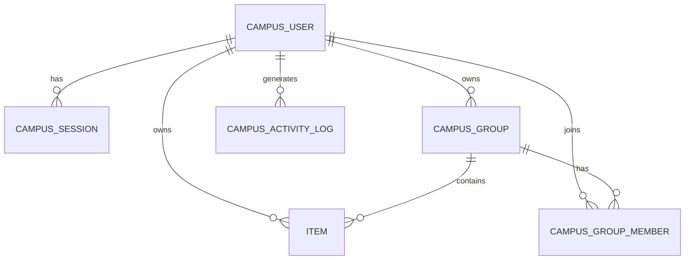
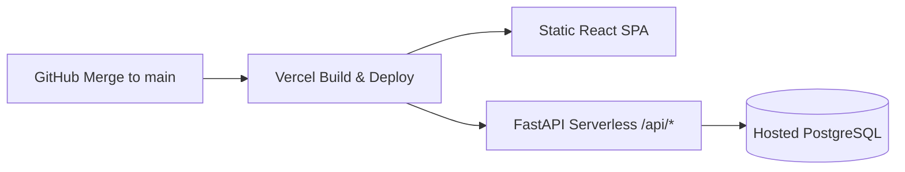

# Technical Design Document (TDD) — Campus Lost & Found

| Field | Value |
|---|---|
| Product | Campus Lost & Found Management System |
| Version | MVP + Beta |
| Releases | MVP — Mid-term, Beta — Final |
| Status | Completed |
| Related docs | [Product Requirements Document (PRD)](01-prd.md), [Software Requirements Specification (SRS)](02-srs.md) |

Sections and tables are marked **MVP** or **Beta**. The MVP parts were built for the mid-term; the Beta parts extend them for the final release.

**Documents in this set**

| Short form | Full form | Purpose | File |
|---|---|---|---|
| PRD | Product Requirements Document | What we build and why | [01-prd.md](01-prd.md) |
| SRS | Software Requirements Specification | Exact requirements, permissions, and acceptance criteria | [02-srs.md](02-srs.md) |
| TDD | Technical Design Document | How we build it: architecture, data model, API, security (this document) | [03-tdd.md](03-tdd.md) |

## 1. Overview

- **MVP:** A FastAPI REST API for lost & found report CRUD (`/api/items`), stored in a SQL database through SQLModel, deployed together with the Vite + React + TypeScript frontend as one Vercel project.
- **Beta:** The same app adds user accounts and login (15-min HS256 JWT + 7-day `HttpOnly` refresh cookie), global roles (`user` / `admin`) enforced by a reusable RBAC module (`backend/rbac.py`), shared Recovery Teams (`/api/groups`) with per-member permissions (`can_create`, `can_edit`, `can_assign`), a 4-tab Admin Dashboard, an Activity Audit Log, a Security Monitor, CSV exports, and automated `pytest` tests.

## 2. Tech stack

| Layer | Choice | Why | Release |
|---|---|---|---|
| API | FastAPI (Python 3.12) | Automatic validation, `/api/docs` OpenAPI UI, and `Depends()` for auth/RBAC | MVP |
| ORM / models | SQLModel | Single class definition for both SQL tables and Pydantic schemas | MVP |
| Database (production) | Hosted PostgreSQL (`DATABASE_URL`) | Persistent cloud SQL storage with `NullPool` for Vercel serverless functions | MVP |
| Database (local) | SQLite (`lost_and_found.db`) | Zero setup needed for local development and `pytest` runs | MVP |
| Frontend | Vite + React 18 + TypeScript | Type-safe components, fast builds, and local `/api` dev proxy | MVP |
| Hosting | Vercel | Hosts both the React SPA and FastAPI `/api/*` functions under one HTTPS domain | MVP |
| JWT | PyJWT (`jwt`) | Standard RFC 7519 HS256 token signing and expiration verification | Beta |
| Password hashing | `pwdlib[argon2]` + HMAC-SHA256 Pepper | Argon2 password hashing mixed with a server-side `PASSWORD_PEPPER` secret | Beta |
| Testing | Pytest + FastAPI `TestClient` | Automated testing of login, refresh, lockout, token rejection, and RBAC rules | Beta |

## 3. Architecture



`vercel.json` routes `/api/*` to the FastAPI backend and everything else to the React frontend. For the same reason, Swagger docs are served at `/api/docs`:

```python
app = FastAPI(title="Campus Lost & Found API", docs_url="/api/docs", openapi_url="/api/openapi.json")
```

### 3.1 Request flow — MVP



### 3.2 Login and refresh flow — Beta



## 4. Project structure

```text
backend/
  main.py                  # FastAPI app, CORS, security headers, router registration, 500 error masking
  models.py                # 6 SQLModel tables and Pydantic request/response schemas
  database.py              # Engine setup (PostgreSQL NullPool / SQLite), column upgrades, SessionDep
  security.py              # Pepper + Argon2 password hashing, HS256 JWT, get_current_user dependency
  rbac.py                  # Centralized RBAC: Permission constants, require_permission, ownership & group guards
  service.py               # Business logic, lockout, token rotation, audit logging, CSV exports, demo seeding
  crud.py                  # Repository layer holding all SQLModel database queries
  .env.example             # Template of required environment variables (no secrets committed)
  requirements.txt         # Python dependencies
  routers/
    items.py               # /api/items (lost & found report CRUD, scoped to owner)
    auth.py                # /api/auth (register, login, refresh, logout, sessions)
    profile.py             # /api/profile (update display name, change password)
    groups.py              # /api/groups (shared Recovery Teams, member permissions, group items)
    admin.py               # /api/admin (stats, users, bans, moderation, audit log, security view, CSV exports)
  tests/
    test_auth_and_rbac.py  # 7 automated pytest tests for auth, lockout, token rejection, and RBAC

frontend/
  src/
    App.tsx                # Session restoration, page routing, and main board state
    api.ts                 # Fetch wrapper with silent 401 refresh rotation and 403 ban logout
    types.ts               # TypeScript interfaces
    index.css              # Responsive dark-theme styles
    components/            # ProtectedRoute, Header, FilterBar, ItemCard, ItemList, ReportModal, ItemDetailModal
    pages/                 # LoginPage, SignupPage, ProfilePage, GroupsPage, AdminPage

docs/
  01-prd.md
  02-srs.md
  03-tdd.md
  FINAL_REPORT.md
```

The backend is cleanly separated by layer: **routers** parse HTTP requests and run `Depends()` checks; **`rbac.py`** and **`security.py`** handle authentication and permission enforcement; **`service.py`** runs business logic and audit logging; and **`crud.py`** executes parameterized SQLModel queries.

## 5. Data model

### 5.1 `item` table — MVP

| Column | Type | Rules |
|---|---|---|
| `id` | integer | Primary key |
| `type` | varchar(20) | `'lost'` or `'found'`, indexed |
| `title` | varchar(150) | Not null, indexed |
| `category` | varchar(80) | Not null, indexed |
| `location` | varchar(150) | Not null |
| `description` | text | Not null |
| `contact_info` | varchar(150) | Not null |
| `status` | varchar(30) | `'active'`, `'claimed'`, or `'resolved'`, default `'active'` |
| `created_at` | timestamp (UTC) | Set automatically on insert |

### 5.2 Full data model — Beta

To avoid reserved SQL keywords (`user`, `group`), the tables are named `campus_user`, `campus_session`, `campus_group`, `campus_group_member`, `item`, and `campus_activity_log`.

**`campus_user`**

| Column | Type | Rules |
|---|---|---|
| `id` | integer | Primary key |
| `name` | varchar(100) | Not null |
| `email` | varchar(150) | Unique, indexed, stored lowercase |
| `password_hash` | varchar | `peppered$` + Argon2 hash, never returned in API responses |
| `role` | varchar(20) | `'user'` or `'admin'`, default `'user'`, indexed |
| `is_banned` | boolean | Default `False`, indexed |
| `banned_at`, `ban_reason` | timestamp, varchar(255) | Nullable |
| `failed_login_count`, `locked_until` | integer, timestamp | Default `0` / nullable (for 15-min lockout after 5 failures) |
| `last_login_at`, `created_at` | timestamp (UTC) | Login and account creation timestamps |

**`campus_session`**

| Column | Type | Rules |
|---|---|---|
| `id` | integer | Primary key |
| `user_id` | integer | FK $\rightarrow$ `campus_user.id`, indexed |
| `token_hash` | varchar(128) | SHA-256 hash of the refresh token, unique, indexed |
| `ip_address`, `user_agent` | varchar(64), varchar(255) | Client IP and browser |
| `created_at`, `last_used_at`, `expires_at` | timestamp (UTC) | Session start, last refresh, and 7-day expiry |
| `revoked_at` | timestamp (UTC) | Nullable; set on logout, session revoke, password change, or ban |

**`campus_group` & `campus_group_member`**

| Table | Columns | Rules |
|---|---|---|
| `campus_group` | `id` (PK), `name`, `description`, `owner_id` (FK $\rightarrow$ `campus_user.id`), `owner_name`, `created_at` | Shared Recovery Team metadata |
| `campus_group_member` | `id` (PK), `group_id` (FK), `user_id` (FK), `user_name`, `user_email`, `group_role` (`'owner'`/`'member'`), `can_create`, `can_edit`, `can_assign`, `joined_at` | Per-member group role and boolean permission flags |

**`item` (new columns in Beta) & `campus_activity_log`**

| Table | Columns | Rules |
|---|---|---|
| `item` (Beta additions) | `owner_id` (FK $\rightarrow$ `campus_user.id`, indexed), `owner_name`, `group_id` (FK $\rightarrow$ `campus_group.id`, nullable, indexed), `assignee_id` (nullable), `assignee_name` | Links each report to its creator and optional Recovery Team / assignee |
| `campus_activity_log` | `id` (PK), `user_id` (nullable, indexed), `user_email`, `action` (indexed), `entity_type`, `entity_id`, `detail`, `ip_address`, `user_agent`, `created_at` (indexed) | Audit trail of logins, lockouts, bans, changes, exports, and RBAC/token rejections |



### 5.3 Schemas

| Schema | Used for | Fields | Release |
|---|---|---|---|
| `ItemCreate` / `ItemUpdate` | `POST` / `PUT` report body | `type`, `title`, `category`, `location`, `description`, `contact_info`, `status`, `group_id?`, `assignee_id?` | MVP / Beta |
| `ItemRead` | Report responses | All `item` columns | MVP |
| `UserCreate` / `UserLogin` | Sign up / Log in | `name`, `email`, `password` / `email`, `password` | Beta |
| `UserRead` | User responses | `id`, `name`, `email`, `role`, `is_banned`, `banned_at`, `ban_reason`, `last_login_at`, `created_at` (never `password_hash`) | Beta |
| `AuthResponse` | Login / Register / Refresh | `access_token`, `token_type: "bearer"`, `expires_in`, `user: UserRead` | Beta |
| `ProfileUpdate` / `PasswordChange` | Profile endpoints | `name` / `current_password`, `new_password` | Beta |
| `SessionRead` | Device sessions list | `id`, `user_id`, `ip_address`, `user_agent`, `created_at`, `last_used_at`, `expires_at`, `is_current` | Beta |
| `GroupCreate` / `GroupUpdate` / `GroupRead` | Recovery Teams | `name`, `description`, `owner_id`, `owner_name`, `member_count`, `my_role`, `my_permissions` | Beta |
| `GroupMemberAdd` / `GroupMemberPermissionUpdate` | Group member management | `email`, `can_create`, `can_edit`, `can_assign` | Beta |
| `AdminStats` / `UserPage` / `UserDetailView` | Admin dashboard | 7-day counts, paginated user list, and user detail drawer | Beta |
| `ActivityLogRead` / `SecuritySummary` | Audit & security tabs | Audit event rows and failed logins grouped by IP and account | Beta |

## 6. REST API design

Base path: `/api`. All bodies and responses use JSON (except CSV exports).

### 6.1 Endpoints — MVP

| Method | Path | Body | Success | Errors | FR |
|---|---|---|---|---|---|
| `POST` | `/api/items` | `ItemCreate` | `201` `ItemRead` | `401`, `422` | FR-01 |
| `GET` | `/api/items` | — | `200` `ItemRead[]` | `401` | FR-02, FR-15 |
| `GET` | `/api/items/{item_id}` | — | `200` `ItemRead` | `401`, `403`, `404` | FR-03, FR-16 |
| `PUT` | `/api/items/{item_id}` | `ItemUpdate` | `200` `ItemRead` | `401`, `403`, `404`, `422` | FR-04, FR-16 |
| `DELETE` | `/api/items/{item_id}` | — | `200` `{"message": ...}` | `401`, `403`, `404` | FR-05, FR-16 |
| `GET` | `/api/health` | — | `200` `{"status": "ok"}` | — | FR-07 |

### 6.2 Endpoints — Beta

**Auth, sessions, and profile**

| Method | Path | Who | Body | Success | Errors | FR |
|---|---|---|---|---|---|---|
| `POST` | `/api/auth/register` (and `/signup`) | Guest | `UserCreate` | `201` `AuthResponse` + cookie | `409`, `422` | FR-08 |
| `POST` | `/api/auth/login` | Guest | `UserLogin` | `200` `AuthResponse` + cookie | `401`, `403`, `429` | FR-10, FR-32 |
| `POST` | `/api/auth/refresh` | Refresh cookie | — | `200` `AuthResponse` + rotated cookie | `401`, `403` | FR-12 |
| `POST` | `/api/auth/logout` | User / Cookie | — | `200`, cookie cleared | — | FR-12 |
| `GET` | `/api/auth/sessions` | User | — | `200` `SessionRead[]` | `401` | FR-14 |
| `DELETE` | `/api/auth/sessions/{session_id}` | User | — | `200` | `401`, `404` | FR-14 |
| `POST` | `/api/auth/sessions/revoke-others`, `/revoke-all` | User | — | `200` | `401` | FR-14 |
| `GET/PUT` | `/api/profile` (and `/api/users/me`) | User | `ProfileUpdate` | `200` `UserRead` | `401`, `422` | FR-13 |
| `POST` | `/api/profile/password` | User | `PasswordChange` | `200` (sessions revoked) | `400`, `401`, `422` | FR-13 |

**Groups (Shared Recovery Teams)**

| Method | Path | Who | Body | Success | Errors | FR |
|---|---|---|---|---|---|---|
| `GET` | `/api/groups` | User | — | `200` `GroupRead[]` | `401` | FR-28 |
| `POST` | `/api/groups` | User | `GroupCreate` | `201` `GroupRead` | `401`, `422` | FR-28 |
| `PATCH` | `/api/groups/{group_id}` | Owner / Admin | `GroupUpdate` | `200` `GroupRead` | `403`, `404` | FR-31 |
| `DELETE` | `/api/groups/{group_id}` | Owner / Admin | — | `200` | `403`, `404` | FR-31 |
| `GET` | `/api/groups/{group_id}/members` | Member / Admin | — | `200` `GroupMemberRead[]` | `403`, `404` | FR-29 |
| `POST` | `/api/groups/{group_id}/members` | Owner / Admin | `GroupMemberAdd` | `201` `GroupMemberRead` | `403`, `404`, `409` | FR-29 |
| `PATCH` | `/api/groups/{group_id}/members/{uid}` | Owner / Admin | `GroupMemberPermissionUpdate` | `200` `GroupMemberRead` | `400`, `403`, `404` | FR-29 |
| `DELETE` | `/api/groups/{group_id}/members/{uid}` | Owner / Self | — | `200` | `400`, `403`, `404` | FR-29 |
| `GET` | `/api/groups/{group_id}/items` | Member / Admin | — | `200` `ItemRead[]` | `403`, `404` | FR-30 |
| `POST` | `/api/groups/{group_id}/items` | Member (`can_create`) | `ItemCreate` | `201` `ItemRead` | `403`, `422` | FR-30 |

**Admin dashboard, audit log, security view & exports**

| Method | Path | Who | Body | Success | Errors | FR |
|---|---|---|---|---|---|---|
| `GET` | `/api/admin/stats` | Admin | — | `200` `AdminStats` | `401`, `403` | FR-18 |
| `GET` | `/api/admin/users?search&role&status&offset&limit` | Admin | — | `200` `UserPage` | `403` | FR-19 |
| `GET` | `/api/admin/users/{user_id}` | Admin | — | `200` `UserDetailView` | `403`, `404` | FR-19 |
| `PATCH` | `/api/admin/users/{user_id}/role` | Admin | `{"role": "..."}` | `200` `UserRead` | `400`, `403`, `404` | FR-20 |
| `POST` | `/api/admin/users/{user_id}/ban`, `/unban` | Admin | `{"reason": "..."}` | `200` `UserRead` | `400`, `403`, `404` | FR-21 |
| `POST` | `/api/admin/users/{user_id}/revoke-sessions` | Admin | — | `200` | `403`, `404` | FR-19 |
| `POST` | `/api/admin/users/bulk-ban`, `/bulk-unban` | Admin | `{"user_ids": [...]}` | `200` `{"affected", "skipped"}` | `403` | FR-23 |
| `GET` | `/api/admin/items`, `/api/admin/groups` | Admin | — | `200` | `403` | FR-24 |
| `POST` | `/api/admin/items/bulk-delete` | Admin | `{"item_ids": [...]}` | `200` `{"affected", "skipped"}` | `403` | FR-23, FR-24 |
| `GET` | `/api/admin/activity?action&search&limit` | Admin | — | `200` `ActivityLogRead[]` | `403` | FR-25 |
| `GET` | `/api/admin/security` | Admin | — | `200` `SecuritySummary` | `403` | FR-26 |
| `GET` | `/api/admin/export/users`, `/items`, `/activity` | Admin | Same query filters | `200` CSV download | `403` | FR-27 |

### 6.3 Examples

Log in:
```http
POST /api/auth/login
Content-Type: application/json

{ "email": "student@campus.edu", "password": "<password>" }
```

```http
200 OK
Set-Cookie: refresh_token=...; HttpOnly; Path=/; Max-Age=604800; SameSite=lax

{
  "access_token": "eyJhbGciOiJIUzI1Ni...",
  "token_type": "bearer",
  "expires_in": 900,
  "user": { "id": 3, "name": "Sakif Ishmam", "email": "student@campus.edu", "role": "user", "is_banned": false }
}
```

### 6.4 Error format

All errors use FastAPI's standard JSON format:
```json
{ "detail": "Insufficient permissions: requires 'admin:dashboard'." }
```
Unhandled exceptions are caught by `unhandled_exception_handler` in `backend/main.py` and return `500` with `{"detail": "Internal server error"}` so stack traces are never leaked to clients.

## 7. Database access

- `backend/database.py` reads `DATABASE_URL` from the environment (defaulting to local SQLite `lost_and_found.db` during development).
- When `DATABASE_URL` points to PostgreSQL (`postgres://` or `postgresql://`), `database.py` normalizes the scheme and configures SQLAlchemy with `poolclass=NullPool` and `connect_args={"prepare_threshold": None}` so serverless functions work reliably with connection poolers.
- On startup, `create_db_and_tables()` creates all tables and applies safe `ALTER TABLE` column upgrades, and `service.seed_initial_data(session)` seeds the 2 Admin accounts, 3 Normal User accounts, sample reports, and the *Main Library Lost & Found Team* group.

## 8. Configuration

| Variable | Local default | Vercel production | Release |
|---|---|---|---|
| `DATABASE_URL` | `sqlite:///./lost_and_found.db` | Hosted PostgreSQL connection string | MVP / Beta |
| `JWT_SECRET` | Local dev fallback | Random 32+ byte secret in Vercel env vars | Beta |
| `PASSWORD_PEPPER` | Local dev fallback | Random 32+ byte secret in Vercel env vars | Beta |
| `ACCESS_TOKEN_MINUTES` | `15` | `15` | Beta |
| `REFRESH_TOKEN_DAYS` | `7` | `7` | Beta |
| `FRONTEND_ORIGIN` | `http://localhost:5173` | `https://campus-lost-found-management-system.vercel.app` | Beta |

No secrets are committed to Git. `.env` and `*.db` are in `.gitignore`, and only `backend/.env.example` is tracked in the repository.

## 9. Deployment



- Pushing or merging to `main` automatically deploys both the React frontend and FastAPI backend on Vercel.
- `vercel.json` routes `/api/(.*)` to `backend/main.py` and SPA routes to `index.html` so deep links and page reloads work cleanly.

## 10. Auth and RBAC design — Beta

### 10.1 Tokens

| Token | Format | Lifetime | Where it lives |
|---|---|---|---|
| Access token | HS256 JWT (`sub`, `email`, `role`, `iat`, `exp`) | 15 min | Browser `localStorage` (`campus_lf_token`), sent as `Authorization: Bearer <token>` |
| Refresh token | Random 32-byte URL-safe string | 7 days | `HttpOnly` cookie (`refresh_token`); database stores only its SHA-256 hash in `campus_session` |

- **Refresh rotation:** `POST /api/auth/refresh` verifies the cookie's SHA-256 hash in `campus_session`, replaces `token_hash` with a newly generated token hash, and returns a fresh 15-minute JWT.
- **Logout & session revocation:** Sets `revoked_at = utc_now()` on the `campus_session` row and clears the cookie. Users can also view all active device sessions on their Profile page and revoke any session.

### 10.2 Passwords and login lockout

- Before Argon2 hashing, `_apply_pepper()` computes `HMAC-SHA256(PASSWORD_PEPPER, plain_password)`. Stored hashes are prefixed with `peppered$`.
- Wrong password increments `user.failed_login_count`. At 5 consecutive failures, `user.locked_until` is set to `now + 15 minutes` and login returns `429 Too Many Requests`. A successful login resets `failed_login_count = 0`.

### 10.3 Permission checks (`backend/rbac.py`)

All role, ownership, and group permission checks go through `backend/rbac.py`:
- **`Permission` constants & `ROLE_PERMISSIONS`:** Maps `"user"` and `"admin"` roles to their allowed permission sets.
- **`require_permission(Permission.X)`:** FastAPI dependency attached to endpoints (such as `/api/admin/*`). If a caller's role lacks the permission, it logs `rbac_denied` and raises `403 Forbidden`.
- **`enforce_item_ownership`:** Ensures `item.owner_id == current_user.id` (or `current_user.role == "admin"`) on personal report read, edit, and delete (`403` otherwise).
- **`enforce_group_permission`:** Checks the caller's row in `campus_group_member`. Group `owner` has full control; regular members must have the matching boolean flag (`can_create`, `can_edit`, `can_assign`), while delete, rename, and member management require `owner_only=True` (`403` otherwise).
- **Immediate ban check:** `get_optional_user` in `backend/security.py` loads the user from the database on every request and checks `if user.is_banned:`, returning `403 ("Account banned")` on the user's very next request.

## 11. Security — Beta

| Area | Design |
|---|---|
| Passwords | HMAC-SHA256 `PASSWORD_PEPPER` + Argon2 (`pwdlib[argon2]`), never stored or returned in plain text |
| Tokens | 15-min HS256 JWT + 7-day `HttpOnly` refresh cookie (SHA-256 hashed in DB and rotated on refresh) |
| Brute force | 5 failed logins lock the account for 15 minutes (`429 Too Many Requests`) |
| CORS & headers | CORS restricted to `FRONTEND_ORIGIN`; middleware sets `X-Content-Type-Options: nosniff`, `X-Frame-Options: DENY`, and `Referrer-Policy` |
| Audit & attack monitoring | `campus_activity_log` records `login`, `failed_login`, `token_rejected`, `rbac_denied`, `user_ban`, `role_change`, `item_delete`, and `data_export` with IP and User-Agent; `/api/admin/security` aggregates failed logins by IP and account |
| SQL injection & over-posting | Parameterized SQLModel queries only; input schemas exclude `role`, `is_banned`, `password_hash`, and `owner_id` |
| Error masking | Global exception handler returns a generic `500` message and never exposes stack traces |

## 12. Risks

| Risk | Mitigation |
|---|---|
| Serverless cold starts on Vercel | Keep dependencies lightweight and use `NullPool` for database connections |
| Ephemeral filesystem on Vercel | Use hosted PostgreSQL (`DATABASE_URL`) in production instead of `/tmp` SQLite |
| Stolen access token | Short 15-minute expiry (`ACCESS_TOKEN_MINUTES=15`) plus per-request database ban check |
| Cross-user data access (IDOR) | Filter personal queries by `owner_id == current_user.id` and enforce `enforce_item_ownership` / `enforce_group_permission` in `backend/rbac.py`, verified by 7 automated `pytest` tests |
