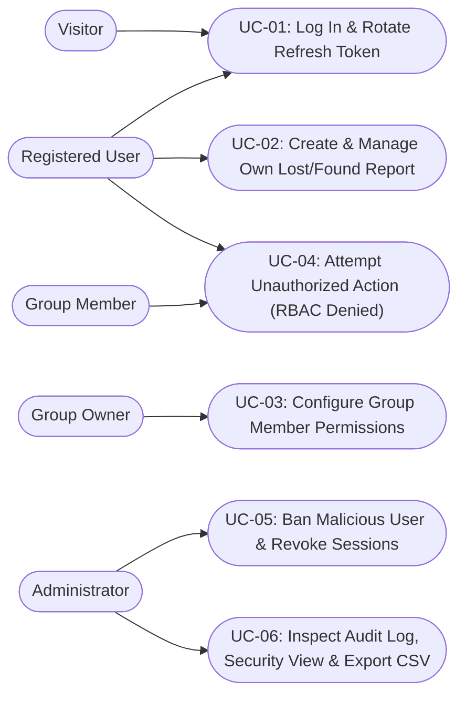
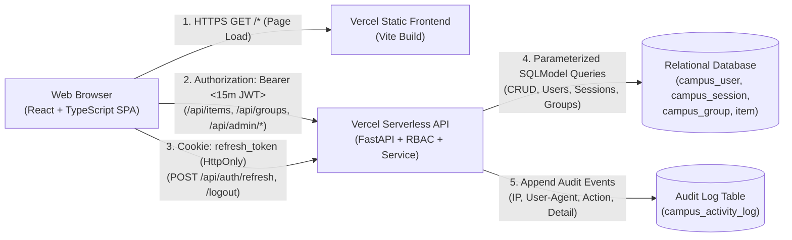
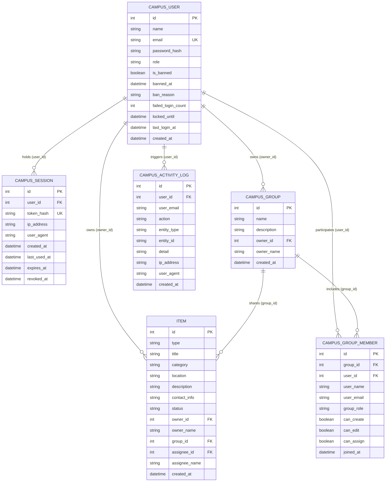
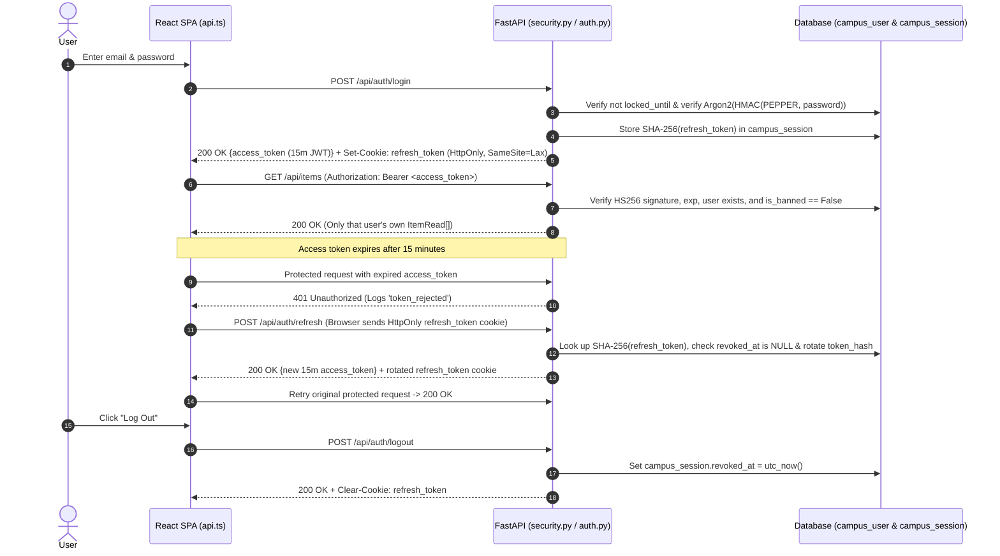
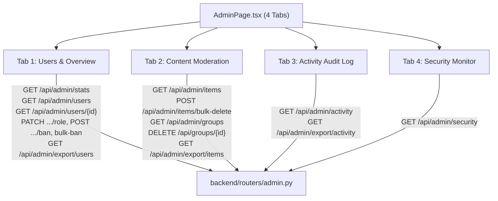
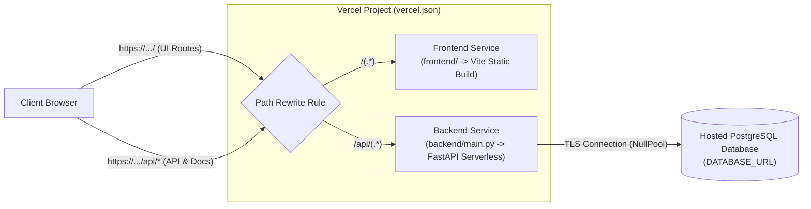

Independent University, Bangladesh  
CSE309 Web Application & Internet  

# Final Project Submission Report

**Submitted by:**  
Name: Sakif Ishmam  
Student ID: 2220681  
Section: Section 6  
Team Number: Individual (1)  

Project Title: Campus Lost & Found Management System  
Vercel URL: https://campus-lost-found-management-system.vercel.app  
GitHub Repository: https://github.com/Ishmam2222/Campus-Lost-Found-Management-System  

**Submitted To:**  
Sayef Reyadh  
Adjunct Lecturer  
Department of Computer Science & Engineering  
Independent University, Bangladesh  

Semester: Autumn 2026  
Date of Submission: 26 November 2026  

---

## Table of Contents

- [1. Executive Summary](#1-executive-summary)
  - [1.1 Project overview](#11-project-overview)
  - [1.2 What was built since the mid assessment](#12-what-was-built-since-the-mid-assessment)
  - [1.3 Live links](#13-live-links)
- [Part A. Product Requirements (PRD)](#part-a-product-requirements-prd)
  - [A1. Problem Statement](#a1-problem-statement)
  - [A2. Users and Roles](#a2-users-and-roles)
  - [A3. Goals and Success Measures](#a3-goals-and-success-measures)
  - [A4. Scope and Non-Goals](#a4-scope-and-non-goals)
  - [A5. User Stories](#a5-user-stories)
- [Part B. Software Requirements (SRS)](#part-b-software-requirements-srs)
  - [B1. Introduction](#b1-introduction)
  - [B2. Functional Requirements](#b2-functional-requirements)
  - [B3. Non-Functional Requirements](#b3-non-functional-requirements)
  - [B4. Roles and Permission Matrix](#b4-roles-and-permission-matrix)
  - [B5. Use Cases](#b5-use-cases)
  - [B6. Acceptance Criteria](#b6-acceptance-criteria)
  - [B7. Traceability Matrix](#b7-traceability-matrix)
- [Part C. Technical Design (TDD)](#part-c-technical-design-tdd)
  - [C1. Technology Stack](#c1-technology-stack)
  - [C2. System Architecture](#c2-system-architecture)
  - [C3. Backend and Frontend Structure](#c3-backend-and-frontend-structure)
  - [C4. Data Model](#c4-data-model)
  - [C5. API Design](#c5-api-design)
  - [C6. JWT Authentication Design](#c6-jwt-authentication-design)
  - [C7. RBAC Design](#c7-rbac-design)
  - [C8. Admin Dashboard Design](#c8-admin-dashboard-design)
  - [C9. Security Design and Threats](#c9-security-design-and-threats)
  - [C10. Deployment on Vercel](#c10-deployment-on-vercel)
  - [C11. Testing](#c11-testing)
- [Part D. Evidence: Screenshots of the Running Application](#part-d-evidence-screenshots-of-the-running-application)
  - [D1. User Side](#d1-user-side)
  - [D2. Security Behaviour](#d2-security-behaviour)
  - [D3. Admin Dashboard](#d3-admin-dashboard)
  - [D4. Deployment](#d4-deployment)
  - [D5. Tests](#d5-tests)
- [Part E. Project Management and Conclusion](#part-e-project-management-and-conclusion)
  - [E1. How to Run and Test](#e1-how-to-run-and-test)
  - [E2. GitHub Work](#e2-github-work)
  - [E3. Limitations](#e3-limitations)
  - [E4. Future Work](#e4-future-work)
  - [E5. Sources, Libraries and Tools](#e5-sources-libraries-and-tools)
- [Appendix. Test Accounts and Video Demo](#appendix-test-accounts-and-video-demo)

### List of Figures, Tables, and Screenshots

**Figures**
- **Figure 1:** Use Case Diagram (`Part B5`)
- **Figure 2:** System Architecture Diagram (`Part C2`)
- **Figure 3:** Database Entity-Relationship (ER) Diagram (`Part C4`)
- **Figure 4:** JWT Authentication, Refresh Rotation & Logout Sequence Diagram (`Part C6`)
- **Figure 5:** Request Authorization & RBAC Decision Flow Diagram (`Part C7`)
- **Figure 6:** Admin Dashboard Pages & API Call Architecture (`Part C8`)
- **Figure 7:** Vercel Serverless & Database Deployment Layout (`Part C10`)

**Tables**
- **Table 1:** Live Deployment and Repository Links (`Section 1.3`)
- **Table 2:** Users and Roles (`Part A2`)
- **Table 3:** Goals and Success Measures (`Part A3`)
- **Table 4:** User Stories (`Part A5`)
- **Table 5:** Functional Requirements — Authentication & JWT (`FR-AUTH-*`) (`Part B2`)
- **Table 6:** Functional Requirements — RBAC & Shared Groups (`FR-RBAC-*`) (`Part B2`)
- **Table 7:** Functional Requirements — Admin Dashboard & Audit (`FR-ADM-*`) (`Part B2`)
- **Table 8:** Functional Requirements — Lost & Found Domain (`FR-DOMAIN-*`) (`Part B2`)
- **Table 9:** Non-Functional Requirements (`NFR-*`) (`Part B3`)
- **Table 10:** Endpoint Groups Against Roles (`Part B4`)
- **Table 11:** Shared Recovery Group Permissions (`Part B4`)
- **Table 12:** System Administrator Safety & Scope Rules (`Part B4`)
- **Table 13:** Detailed Use Case Descriptions (`UC-01` to `UC-06`) (`Part B5`)
- **Table 14:** Acceptance Criteria (`Given / When / Then`) (`Part B6`)
- **Table 15:** End-to-End Requirement Traceability Matrix (`Part B7`)
- **Table 16:** Technology Stack (`Part C1`)
- **Table 17:** `campus_user` Table Schema (`Part C4`)
- **Table 18:** `campus_session` Table Schema (`Part C4`)
- **Table 19:** `campus_group` Table Schema (`Part C4`)
- **Table 20:** `campus_group_member` Table Schema (`Part C4`)
- **Table 21:** `item` Table Schema (`Part C4`)
- **Table 22:** `campus_activity_log` Table Schema (`Part C4`)
- **Table 23:** Complete REST API Endpoint Specification (`Part C5`)
- **Table 24:** JWT Access Token Claims (`Part C6`)
- **Table 25:** Admin Dashboard Tabs, Endpoints, Filters, Actions & Audit Events (`Part C8`)
- **Table 26:** Security Threats, Defences & Implementation Modules (`Part C9`)
- **Table 27:** Environment Variable Specification (`Part C10`)
- **Table 28:** Automated Pytest Verification Results (`Part C11`)
- **Table 29:** GitHub Issues and Pull Requests History (`Part E2`)
- **Table 30:** Sources, Libraries, and Tools Used (`Part E5`)

---

## 1. Executive Summary

### 1.1 Project overview
The **Campus Lost & Found Management System** is a secure, multi-user web application built for university students, faculty, and campus security desks to report, search, verify, and return lost or found belongings across campus. Instead of relying on scattered social media posts or unindexed paper logbooks at building entrances, campus members sign in to manage their personal lost and found reports, collaborate within departmental recovery teams (such as library or cafeteria desks), and track item handovers from `active` to `claimed` and `resolved`. The stack is **React 18 with TypeScript and Vite** on the frontend, **FastAPI with SQLModel (Python 3.12)** on the backend, a relational SQL database (**PostgreSQL / SQLite**), deployed on **Vercel**.

### 1.2 What was built since the mid assessment
- **JWT authentication with refresh and logout:** Added user registration and login using HMAC-SHA256 server-side `PASSWORD_PEPPER` + Argon2 password hashing, short-lived 15-minute HS256 JWT access tokens, `HttpOnly` refresh token cookies stored as SHA-256 hashes in `campus_session`, silent token rotation via `/api/auth/refresh`, session invalidation on logout, and a Profile session table to list and revoke device sessions.
- **Role based access control (roles, ownership, group permissions):** Created a centralized `backend/rbac.py` module and frontend `ProtectedRoute.tsx` guard enforcing global roles (`user`, `admin`), strict personal report read/write/delete ownership rules (`403` when reading or modifying another user's personal report), and shared **Recovery Teams** (`/api/groups`) where the group owner assigns per-member permissions (`can_create`, `can_edit`, `can_assign`) and retains exclusive owner rights over deletion, renaming, and member management.
- **Admin dashboard (users, content, activity log, security view, exports):** Built a 4-tab Admin Center featuring 7-day trend metrics, paginated user search/filtering, a User Detail Inspector modal (reports, groups, active sessions, recent activity), role toggling, single/bulk ban and unban with reasons, single/bulk report and group moderation, a searchable Activity Audit Log, a Security View summarizing failed logins by IP and account, and filter-aware CSV exports.
- **Audit logging, brute-force protection, deployment on Vercel:** Implemented automatic audit recording (`campus_activity_log`) with user email, IP address, and browser User-Agent, a 15-minute brute-force account lockout (`429 Too Many Requests`) after 5 consecutive failed logins, strict security headers, and an automated `pytest` suite verified on the live Vercel deployment.

### 1.3 Live links

**Table 1: Live Deployment and Repository Links**

| Resource | Live Link |
| :--- | :--- |
| **GitHub Repository** | https://github.com/Ishmam2222/Campus-Lost-Found-Management-System |
| **Vercel Frontend URL** | https://campus-lost-found-management-system.vercel.app |
| **Vercel API URL** | https://campus-lost-found-management-system.vercel.app/api/items |
| **Vercel API Docs URL** | https://campus-lost-found-management-system.vercel.app/api/docs |
| **Video Demo Link** | *(Inserted in Final Submission Form and PDF Appendix)* |

---

## Part A. Product Requirements (PRD)

### A1. Problem Statement
Every week at a university campus, dozens of essential student and staff belongings—including university ID cards, scientific calculators, laptops, chargers, keys, notebooks, and wallets—are misplaced in lecture halls, libraries, laboratories, and cafeterias. Currently, students cope by posting unstructured messages in large Facebook or WhatsApp groups, or by walking from building to building asking guards if an item was turned in. Posts in chat groups are buried within hours, offer no category or status filtering, and provide no central visibility into whether an item has already been claimed.

Furthermore, campus volunteer desks and security offices operate in teams where multiple student assistants log found items across shifts. Without user authentication, record ownership, and fine-grained team permissions, any visitor could read, alter, or delete someone else's private report, impersonate an owner, or flood the board with spam without an audit trail or administrative moderation.

### A2. Users and Roles

**Table 2: Users and Roles**

| Role | Who They Are | Main Tasks | What They Must Never Be Able To Do |
| :--- | :--- | :--- | :--- |
| **Visitor** | Unauthenticated campus visitor | Access the Login and Sign Up pages (`ProtectedRoute` blocks all app pages until authenticated) | Must never access `/api/items`, `/api/profile`, `/api/groups`, `/api/admin/*`, or read/edit/delete any report (`401 Unauthorized`) |
| **User (`user`)** | Registered campus student, faculty, or staff member | Create lost/found reports, read/update/delete only their own personal reports, update profile name, change password, list and revoke active device sessions, and create or join recovery groups | Must never read, update, or delete another user's personal report (`403 Forbidden`), assign themselves the `admin` role, or access any `/api/admin/*` route (`403 Forbidden`) |
| **Group Member** | Registered user added to a shared Recovery Team | View shared group reports and perform only the specific actions enabled on their membership record (`can_create`, `can_edit`, `can_assign`) | Must never perform ungranted group actions (`403`), delete group reports (`403`), rename/delete the group (`403`), or manage group members (`403`) |
| **Group Owner** | Registered user who created a shared Recovery Team | Create, edit, assign, and delete group reports; rename or delete the group; add/remove members by email and configure each member's `can_create`, `can_edit`, and `can_assign` flags | Must never access system-wide `/api/admin/*` endpoints or read/modify private reports outside their group/ownership (`403 Forbidden`) |
| **Admin (`admin`)** | Campus security supervisor or platform moderator | View 7-day overview stats, search/filter/paginate users, inspect user detail drawers, change user roles, ban/unban users (single or bulk), moderate/delete any report or group, inspect the audit log and security view, and export filtered CSV files | Must never change their own role (`400 Bad Request`) or ban themselves or another administrator (`400 Bad Request`) |

### A3. Goals and Success Measures

**Table 3: Goals and Success Measures**

| Goal ID | Goal Statement | Testable Success Measure |
| :--- | :--- | :--- |
| **GOAL-01** | Centralize campus lost and found reporting with instant search and filtering | 100% of authenticated CRUD operations (`POST`, `GET`, `PUT`, `DELETE /api/items`) complete in `< 300 ms` with accurate type, category, and keyword filtering |
| **GOAL-02** | Enforce short-lived, revocable JWT authentication with strong password cryptography | Access tokens expire in `<= 15 minutes` (`900 seconds`); passwords use HMAC-SHA256 `PASSWORD_PEPPER` + Argon2; revoked sessions and expired/tampered tokens return `HTTP 401` on 100% of protected requests |
| **GOAL-03** | Prevent unauthorized cross-user data access and privilege escalation | 0% of normal users can read, modify, or delete another user's personal report or access `/api/admin/*` (100% rejected with `HTTP 403` and recorded in `campus_activity_log`) |
| **GOAL-04** | Enable shared departmental recovery desks with fine-grained team permissions | Group members can only execute actions matching their boolean permission grants (`can_create`, `can_edit`, `can_assign`); 100% of non-owner delete/rename/member-management calls return `HTTP 403` |
| **GOAL-05** | Provide brute-force login protection and immediate account suspension | 5 consecutive wrong password attempts lock the account for `15 minutes` (`HTTP 429`); banning a user immediately rejects their very next request with `HTTP 403` |

### A4. Scope and Non-Goals
- **In Scope:**
  - **Domain Features:** Lost & found report creation, list filtering (type, category, status, keyword search), single report detail inspection, status transitions (`active`, `claimed`, `resolved`), and deletion.
  - **Authentication & Sessions:** Signup, login, logout, server-side `PASSWORD_PEPPER` + Argon2 password hashing, 15-minute HS256 JWT access tokens, `HttpOnly` refresh cookies backed by SHA-256 database hashes, token rotation, device session listing/revocation, profile name updates, and audited password changes.
  - **RBAC & Recovery Groups:** Centralized `backend/rbac.py` module, `ProtectedRoute.tsx` guard, strict read/write ownership enforcement, shared Recovery Teams (`/api/groups`) with per-member `can_create`, `can_edit`, and `can_assign` flags, and owner-only group administration.
  - **Admin Dashboard & Audit:** Overview statistics (with 7-day new counts), paginated user table with search and role/status filters, user detail inspector modal, single and bulk ban/unban, single and bulk report deletion, activity audit log, security view (failed logins by IP and account), and filter-aware CSV exports.
  - **Deployment & Verification:** Automated `pytest` suite and live Vercel deployment.
- **Out of Scope (Non-Goals):**
  - *AI Image Matching & Camera Uploads:* Excluded to avoid third-party cloud blob storage costs and keep the application fast and self-contained.
  - *External SMS/Email Gateways:* Excluded so demo testing works deterministically without external SMTP dependencies.
- **Assumptions and Constraints:**
  - Runs in modern desktop and mobile web browsers supporting ES2020 and `HttpOnly` cookies over HTTPS.
  - Deployed on Vercel serverless functions where all secrets are injected via environment variables.

### A5. User Stories

**Table 4: User Stories**

| ID | Role | User Story (`As a ... I want ... so that ...`) |
| :--- | :--- | :--- |
| **US-01** | Campus Student (`user`) | **As a** student, **I want** to sign up and log in with my campus email and a securely hashed password **so that** my lost and found reports are linked to my verified account. |
| **US-02** | Signed-In User (`user`) | **As a** signed-in user, **I want** my short-lived access token to refresh automatically via an `HttpOnly` cookie and view/revoke my active device sessions **so that** my account stays secure across campus lab computers. |
| **US-03** | Signed-In User (`user`) | **As a** signed-in user, **I want** to update my display name and change my password by verifying my current password **so that** I can maintain my account security. |
| **US-04** | Report Owner (`user`) | **As a** report owner, **I want** the server to block other users from reading, editing, or deleting my personal report (`403 Forbidden`) **so that** my private records cannot be accessed or tampered with. |
| **US-05** | Recovery Team Owner | **As a** recovery group owner, **I want** to create a shared group (e.g., *Main Library Lost & Found Team*), add members by email, and toggle each member's `can_create`, `can_edit`, and `can_assign` permissions **so that** student volunteers only have the exact access they need. |
| **US-06** | Recovery Team Member (`can_create` only) | **As a** junior desk volunteer with `can_create` permission only, **I want** to log newly found items into our team desk while being restricted from editing, assigning, or deleting items **so that** desk records cannot be accidentally altered or erased. |
| **US-07** | Recovery Team Member (`can_edit` + `can_assign`) | **As a** senior desk volunteer with `can_edit` and `can_assign` permissions, **I want** to update a found item's status to `claimed` and assign a team handler **so that** our team knows who is handling the return. |
| **US-08** | Administrator (`admin`) | **As an** administrator, **I want** to view system-wide statistics (including users and reports created in the last 7 days), search/filter users, and inspect a user's reports, groups, sessions, and activity **so that** I have full visibility over campus activity. |
| **US-09** | Administrator (`admin`) | **As an** administrator, **I want** to ban or unban malicious users (individually or in bulk) with a reason and moderate/bulk-delete spam reports **so that** banned users are blocked on their very next request. |
| **US-10** | Administrator (`admin`) | **As an** administrator, **I want** to inspect the Activity Audit Log, monitor failed logins by IP and account in the Security View, and export filtered Users, Reports, and Activity to CSV **so that** I can audit security incidents and produce compliance reports. |

---

## Part B. Software Requirements (SRS)

### B1. Introduction
- **Purpose:** This Software Requirements Specification defines the exact, verifiable functional and non-functional requirements, RBAC permission matrices, use cases, and acceptance criteria for the **Campus Lost & Found Management System**.
- **Intended Readers:** Course instructor, teaching assistants, software developers, and security auditors evaluating the CSE309 Final Project.
- **Definitions:**
  - **JWT (JSON Web Token):** A compact, cryptographically signed token (RFC 7519) encoding claims (`sub`, `email`, `role`, `iat`, `exp`) verified on every protected HTTP request.
  - **Access Token:** Short-lived JWT (`<= 15 minutes`) sent in the `Authorization: Bearer <token>` header.
  - **Refresh Token:** Long-lived random credential (`7 days`) stored in an `HttpOnly` cookie and verified against its SHA-256 hash in `campus_session` to issue a new access token.
  - **Password Pepper:** A server-side secret (`PASSWORD_PEPPER`) stored in environment variables and mixed into passwords via HMAC-SHA256 prior to Argon2 hashing.
  - **RBAC (Role-Based Access Control):** Authorization model where server endpoints verify the caller's role (`user`, `admin`), permission constants, record ownership, and group membership flags.
  - **Audit Log:** Immutable server-side event trail (`campus_activity_log`) recording authentication, authorization, moderation, and export actions with timestamp, user, IP address, and browser User-Agent.
- **References:**
  - IETF RFC 7519 — *JSON Web Token (JWT)*
  - OWASP Application Security Verification Standard (ASVS 4.0) — *Authentication, Session Management, and Access Control*
  - FastAPI & SQLModel Official Documentation

### B2. Functional Requirements

**Table 5: Functional Requirements — Authentication & JWT (`FR-AUTH`)**

| ID | Requirement Specification |
| :--- | :--- |
| **FR-AUTH-01** | The system shall allow a visitor to create a new account (`POST /api/auth/register`) with name, email, and password (minimum 6 characters), assigning the default role `user` and returning `409 Conflict` for duplicate emails. |
| **FR-AUTH-02** | The system shall combine every password with a server-side `PASSWORD_PEPPER` environment secret via HMAC-SHA256 before hashing with Argon2 (or PBKDF2-SHA256 fallback) and shall never store or return plain-text passwords. |
| **FR-AUTH-03** | The system shall authenticate users via `POST /api/auth/login` and issue a signed HS256 JWT access token with a lifetime of 15 minutes (`expires_in = 900`) containing `sub` (user ID), `email`, `role`, `iat`, and `exp`. |
| **FR-AUTH-04** | The system shall verify the JWT access token on every protected request and return `401 Unauthorized` when the token is missing, malformed, tampered with, or expired. |
| **FR-AUTH-05** | The system shall issue an `HttpOnly` refresh token cookie on login/signup, store only its SHA-256 hash in `campus_session`, rotate the token hash on `POST /api/auth/refresh`, and revoke the session in the database on `POST /api/auth/logout`. |
| **FR-AUTH-06** | The system shall allow an authenticated user to list their active login sessions (`GET /api/auth/sessions`) with IP address and browser User-Agent, and revoke an individual session, all other sessions, or all sessions everywhere. |
| **FR-AUTH-07** | The system shall lock a user account for 15 minutes (`locked_until`) after 5 consecutive failed login attempts and reject login requests during the lockout window with `429 Too Many Requests`. |
| **FR-AUTH-08** | The system shall allow an authenticated user to update their display name (`PUT /api/profile`) and change their password (`POST /api/profile/password`) only after verifying their current password, recording failed attempts in the audit log and revoking existing refresh sessions on success. |

**Table 6: Functional Requirements — RBAC & Shared Groups (`FR-RBAC`)**

| ID | Requirement Specification |
| :--- | :--- |
| **FR-RBAC-01** | The system shall store each user's role (`user` or `admin`) in the database and enforce role permissions on the server for every protected endpoint through a single centralized module (`backend/rbac.py`). |
| **FR-RBAC-02** | The system shall enforce record ownership so that a normal user can only read, update, or delete personal reports where `item.owner_id == current_user.id`, returning `403 Forbidden` for any other user's personal report. |
| **FR-RBAC-03** | The system shall allow authenticated users to create shared Recovery Groups (`POST /api/groups`) where the creator is assigned `group_role = "owner"` with full permissions. |
| **FR-RBAC-04** | The system shall enforce fine-grained group member permissions (`can_create`, `can_edit`, `can_assign`) so that members without the required flag receive `403 Forbidden` when attempting to create, edit, or assign a group report. |
| **FR-RBAC-05** | The system shall restrict group report deletion, group renaming, group deletion, adding/removing members, and updating member permissions exclusively to the group `owner` (or system `admin`), returning `403 Forbidden` to regular group members. |
| **FR-RBAC-06** | The system shall prevent an administrator from changing their own role (`400 Bad Request`) or banning themselves or another administrator (`400 Bad Request`). |
| **FR-RBAC-07** | The system shall check `user.is_banned` on every authenticated request and immediately reject a banned user on their very next request with `403 Forbidden ("Account banned")`. |

**Table 7: Functional Requirements — Admin Dashboard & Audit (`FR-ADM`)**

| ID | Requirement Specification |
| :--- | :--- |
| **FR-ADM-01** | The system shall provide `GET /api/admin/stats` returning total users, admins, banned users, total reports, lost/found/claimed counts, total groups, and new users/reports created in the last 7 days. |
| **FR-ADM-02** | The system shall provide `GET /api/admin/users` supporting text search (name/email), role filter, ban status filter, and pagination (`offset`, `limit`), and `GET /api/admin/users/{id}` returning the user's reports, groups, active sessions, and recent activity. |
| **FR-ADM-03** | The system shall allow administrators to ban and unban users with a reason, change a user's role between `user` and `admin`, force-revoke a user's active sessions, and execute bulk ban and bulk unban operations (`POST /api/admin/users/bulk-ban`, `bulk-unban`). |
| **FR-ADM-04** | The system shall allow administrators to list and filter all reports and recovery groups, delete individual reports or groups, and bulk-delete selected reports (`POST /api/admin/items/bulk-delete`). |
| **FR-ADM-05** | The system shall record authentication, password change, role change, ban/unban, report/group deletion, CSV export, token rejection, and RBAC denial events in `campus_activity_log` with user email, IP address, browser User-Agent, and timestamp, searchable via `GET /api/admin/activity`. |
| **FR-ADM-06** | The system shall provide a Security View (`GET /api/admin/security`) aggregating failed logins by IP address and by account, and provide filter-aware CSV exports (`GET /api/admin/export/users`, `items`, `activity`). |

**Table 8: Functional Requirements — Lost & Found Domain (`FR-DOMAIN`)**

| ID | Requirement Specification |
| :--- | :--- |
| **FR-DOMAIN-01** | The system shall allow an authenticated user to create a lost or found report (`POST /api/items`) with `type` (`lost` or `found`), `title`, `category`, `location`, `description`, `contact_info`, and `status`, attaching `owner_id` and `owner_name`. |
| **FR-DOMAIN-02** | The system shall allow listing the signed-in user's own reports (`GET /api/items`) ordered newest first with optional filters for `type`, `category`, `status`, and `search` keyword, and viewing single report details via `GET /api/items/{item_id}` (`403` if owned by another user, `404` if missing). |
| **FR-DOMAIN-03** | The system shall allow authorized owners, permitted group members (`can_edit` / `can_assign`), and admins to update report details, status (`active`, `claimed`, `resolved`), or assignee via `PUT /api/items/{item_id}`, and delete reports via `DELETE /api/items/{item_id}`. |

### B3. Non-Functional Requirements

**Table 9: Non-Functional Requirements**

| ID | Category | Measurable Requirement Specification |
| :--- | :--- | :--- |
| **NFR-SEC-01** | Security | The system shall load `JWT_SECRET`, `PASSWORD_PEPPER`, and `DATABASE_URL` from environment variables, commit only `.env.example`, and return a generic `401 "Invalid email or password."` on login failure without revealing whether the email exists. |
| **NFR-SEC-02** | Security | The system shall set `X-Content-Type-Options: nosniff`, `X-Frame-Options: DENY`, and `Referrer-Policy` headers on every HTTP response and never expose stack traces in `500` responses. |
| **NFR-PERF-01** | Performance | The system shall enforce pagination bounds on user listings (`1 <= limit <= 100`, default `20`) and cap bulk operations at 50 IDs per request, responding in `< 300 ms` under normal load. |
| **NFR-USA-01** | Usability | The React frontend shall guard all protected pages behind `ProtectedRoute.tsx` and render a responsive layout with loading spinners, empty states, clear error alerts, and zero guest-link flashing while restoring an active session. |
| **NFR-REL-01** | Reliability | The backend shall support persistent hosted PostgreSQL (`DATABASE_URL` with SQLAlchemy `NullPool` for serverless) as well as local SQLite so data persists across restarts. |
| **NFR-MAINT-01** | Maintainability | All RBAC permission constants and dependencies shall reside in one module (`backend/rbac.py`), and at least 7 automated `pytest` tests shall verify login, lockout, token rejection, and RBAC rules. |

### B4. Roles and Permission Matrix

**Table 10: Endpoint Groups Against Roles**

| Endpoint Group | Visitor (Guest) | Normal User (`user`) | Group Member | Group Owner | Admin (`admin`) |
| :--- | :---: | :---: | :---: | :---: | :---: |
| `GET /api/health`, `POST /api/auth/register`, `POST /api/auth/login` | Yes | Yes | Yes | Yes | Yes |
| `GET /api/items`, `GET /api/items/{id}`, `PUT /api/items/{id}`, `DELETE /api/items/{id}` (Personal Item) | No (`401`) | **Own only** (`403` others) | **Own only** | **Own only** | Yes (All) |
| `GET/PUT /api/profile`, `POST /api/profile/password`, `/api/auth/sessions` | No (`401`) | **Own only** | **Own only** | **Own only** | **Own only** |
| `GET /api/groups`, `POST /api/groups` | No (`401`) | Yes | Yes | Yes | Yes |
| `POST /api/groups/{id}/items`, `PUT /api/items/{id}` (Group Item) | No (`401`) | No (`403`) | **If granted flag** | Yes | Yes |
| `DELETE /api/items/{id}` (Group Item), `PATCH/DELETE /api/groups/{id}`, Manage Members | No (`401`) | No (`403`) | No (`403`) | **Yes (Owner)** | Yes |
| `/api/admin/stats`, `/api/admin/users`, `/api/admin/items`, `/api/admin/activity`, `/api/admin/security`, `/api/admin/export/*` | No (`401`) | No (`403`) | No (`403`) | No (`403`) | **Yes (Admin only)** |

**Table 11: Shared Recovery Group Permissions**

| Group Permission / Role | Create Group Report (`POST /api/groups/{id}/items`) | Edit Group Report Fields & Status (`PUT /api/items/{id}`) | Assign Volunteer Handler (`assignee_id`) | Delete Group Report (`DELETE /api/items/{id}`) | Rename / Delete Group & Add / Remove / Edit Members |
| :--- | :---: | :---: | :---: | :---: | :---: |
| **`can_create = True`** | Allowed (`201`) | Denied (`403`) | Denied (`403`) | Denied (`403`) | Denied (`403`) |
| **`can_edit = True`** | Denied unless `can_create` | Allowed (`200`) | Denied unless `can_assign` | Denied (`403`) | Denied (`403`) |
| **`can_assign = True`** | Denied unless `can_create` | Denied unless `can_edit` | Allowed (`200`) | Denied (`403`) | Denied (`403`) |
| **Group `owner`** | Allowed (`201`) | Allowed (`200`) | Allowed (`200`) | **Allowed (`200`)** | **Allowed (`200`)** |

**Table 12: System Administrator Safety & Scope Rules**

| Rule Area | Enforced Server Behavior | HTTP Status on Violation |
| :--- | :--- | :---: |
| **Self-Role Protection** | An admin cannot demote or modify their own role (`admin_user.id == target_user_id` on `PATCH /api/admin/users/{id}/role`). | `400 Bad Request` |
| **Admin-Ban Protection** | An admin cannot ban themselves or another user whose role is `admin` (`POST /api/admin/users/{id}/ban` and skipped in `bulk-ban`). | `400 Bad Request` |
| **System Admin Moderation in Groups** | System admins have platform-wide moderation authority to inspect or delete any group or group report for content moderation. | `200 OK` |

### B5. Use Cases

**Figure 1: Use Case Diagram**



**Table 13: Detailed Use Case Descriptions**

| Use Case ID & Name | Actor | Preconditions | Main Flow (Numbered Steps) | Alternative & Error Flows (with HTTP Status Codes) | Postconditions |
| :--- | :--- | :--- | :--- | :--- | :--- |
| **UC-01: Log In and Refresh Session** | Registered User | User account exists and is not banned or locked out. | 1. User submits email and password to `POST /api/auth/login`.<br>2. Server verifies peppered Argon2 hash, resets `failed_login_count = 0`, and records `login` in audit log.<br>3. Server returns 15-minute JWT `access_token` (`200 OK`) and sets `HttpOnly` `refresh_token` cookie (SHA-256 hash stored in `campus_session`).<br>4. When JWT expires, client calls `POST /api/auth/refresh`; server validates and rotates `token_hash` and issues a fresh 15-minute JWT. | - **401 Unauthorized:** Wrong email or password; increments `failed_login_count` and logs `failed_login`.<br>- **429 Too Many Requests:** 5th consecutive failure sets `locked_until = now + 15m`.<br>- **403 Forbidden:** User has `is_banned = True`. | User holds a valid 15-minute JWT and an active, rotatable refresh session row. |
| **UC-02: Create a Lost/Found Report** | Registered User | User is authenticated with a valid JWT. | 1. User opens Report Modal and submits title, type (`lost`/`found`), category, location, description, and contact info.<br>2. Frontend sends `POST /api/items` with `Authorization: Bearer <jwt>`.<br>3. Server validates payload via `ItemCreate`, sets `owner_id = current_user.id` and `owner_name = current_user.name`, saves to `item` table, and logs `item_create`.<br>4. Server returns `201 Created` with `ItemRead`. | - **422 Unprocessable Entity:** Title or location is blank or type is invalid.<br>- **401 Unauthorized:** Supplied Bearer token is missing, tampered, or expired. | New report is persisted in database linked to `owner_id` and displayed in the user's personal report list. |
| **UC-03: Change a Group Member's Permissions** | Group Owner | Actor is the `owner` of the group in `campus_group_member`. | 1. Owner opens **Recovery Teams** page and selects their group.<br>2. Owner toggles `can_edit` or `can_assign` checkbox for a member.<br>3. Frontend sends `PATCH /api/groups/{group_id}/members/{member_user_id}`.<br>4. Server verifies caller is group `owner` via `enforce_group_permission(..., owner_only=True)`, updates the flags, and logs `group_permission_update` (`200 OK`). | - **403 Forbidden:** Caller is a normal group member rather than the group `owner`; logs `rbac_denied`.<br>- **400 Bad Request:** Attempt to alter the group owner's own flags.<br>- **404 Not Found:** Group or member does not exist. | Member's granular permissions (`can_create`, `can_edit`, `can_assign`) are updated immediately. |
| **UC-04: Denied Action by RBAC** | Normal User / Group Member | Actor is signed in as a normal `user` or restricted group member. | 1. Actor attempts to read, edit, or delete another user's personal report (`/api/items/{id}`), edit a group item without `can_edit`, or call `/api/admin/stats`.<br>2. `rbac.py` detects missing permission or ownership mismatch.<br>3. Server writes an `rbac_denied` entry to `campus_activity_log` with user email, IP, and User-Agent.<br>4. Server returns `403 Forbidden` with explanatory `detail`. | - **401 Unauthorized:** Actor has no token or expired token (logs `token_rejected`). | Database record remains untouched; denial event is permanently recorded in the audit log. |
| **UC-05: Ban a User** | Administrator (`admin`) | Actor is authenticated with `role == "admin"`. | 1. Admin clicks **Ban** on a user in the Admin Dashboard and enters a reason.<br>2. Frontend sends `POST /api/admin/users/{user_id}/ban`.<br>3. Server verifies `Permission.ADMIN_USERS_MANAGE`, confirms target is not self or another admin, sets `is_banned = True`, revokes all active sessions in `campus_session`, and logs `user_ban` (`200 OK`). | - **400 Bad Request:** Target user is the admin themselves or another administrator.<br>- **403 Forbidden:** Caller is not an admin. | Target user is marked banned, all refresh tokens are revoked, and their very next API call returns `403`. |
| **UC-06: Read Audit Log & Export CSV** | Administrator (`admin`) | Actor is authenticated with `role == "admin"`. | 1. Admin opens the **Activity Audit Log** tab and filters by action (e.g., `rbac_denied` or `failed_login`) or keyword.<br>2. Frontend calls `GET /api/admin/activity?action=...&search=...` (`200 OK`).<br>3. Admin clicks **Export Activity CSV**, triggering `GET /api/admin/export/activity` with the same filters.<br>4. Server generates CSV, logs `data_export`, and streams `activity_export.csv`. | - **403 Forbidden:** Non-admin attempts to read audit log or export CSV. | Filtered audit rows are displayed in the UI and downloaded as a CSV file; export action is audited. |

### B6. Acceptance Criteria

**Table 14: Acceptance Criteria (`Given / When / Then`)**

| Criterion ID | Requirement(s) | Given | When | Then |
| :--- | :--- | :--- | :--- | :--- |
| **AC-01** | `FR-AUTH-03`, `FR-AUTH-04` | A user has an access token whose `exp` timestamp has passed | The client sends a request to `GET /api/profile` with `Authorization: Bearer <expired_jwt>` | The server rejects the request with `HTTP 401 Unauthorized` and logs `token_rejected` in `campus_activity_log`. |
| **AC-02** | `FR-AUTH-04` | A valid JWT access token has its signature or payload characters modified | The client sends the tampered token to any protected endpoint | Signature verification fails, the server returns `HTTP 401 Unauthorized`, and records `token_rejected`. |
| **AC-03** | `FR-RBAC-02` | User A (`student@campus.edu`) created report `#1`, and User B (`alice@campus.edu`) is logged in | User B sends `GET /api/items/1`, `PUT /api/items/1`, or `DELETE /api/items/1` | The server denies the request with `HTTP 403 Forbidden` and logs `rbac_denied`. |
| **AC-04** | `FR-RBAC-04`, `FR-RBAC-05` | `rafi@campus.edu` is a member of *Main Library Lost & Found Team* with `can_create=True, can_edit=False, can_assign=False` | Rafi sends `PUT /api/items/{group_item_id}` to change status or assignee, or `DELETE /api/items/{group_item_id}` | The server rejects the request with `HTTP 403 Forbidden`. |
| **AC-05** | `FR-RBAC-07` | User `rafi@campus.edu` holds a currently valid, non-expired JWT access token | An administrator bans `rafi@campus.edu` via `POST /api/admin/users/{id}/ban`, and Rafi immediately calls `GET /api/profile` | The server checks `user.is_banned` in `get_optional_user` and immediately returns `HTTP 403 Forbidden ("Account banned")`. |
| **AC-06** | `FR-RBAC-06` | `admin@campus.edu` is logged in as an administrator | `admin@campus.edu` calls `POST /api/admin/users/{moderator_id}/ban` on another admin or `PATCH /api/admin/users/{self_id}/role` | The server rejects both actions with `HTTP 400 Bad Request`. |
| **AC-07** | `FR-AUTH-07` | An account exists for `lockout_test@campus.edu` | A client submits 5 consecutive login requests with an incorrect password | The 5th request (and any subsequent login attempt for 15 minutes) returns `HTTP 429 Too Many Requests`. |

### B7. Traceability Matrix

**Table 15: End-to-End Requirement Traceability Matrix**

| Requirement ID | Implementing Endpoint / Frontend Screen | Automated Test (`backend/tests/test_auth_and_rbac.py`) | Evidence Screenshot |
| :--- | :--- | :--- | :---: |
| **FR-AUTH-01** | `POST /api/auth/register` / `SignupPage.tsx` | `test_brute_force_login_lockout` (registers account) | **S1** |
| **FR-AUTH-02** | `security.py` (`_apply_pepper`, `hash_password`) | `test_login_and_refresh_flow` | **S1**, **S19** |
| **FR-AUTH-03** | `POST /api/auth/login` / `LoginPage.tsx` | `test_login_and_refresh_flow` | **S1**, **S7** |
| **FR-AUTH-04** | `security.py` (`get_optional_user`, `get_current_user`) | `test_token_rejection_missing_tampered_and_expired` | **S7**, **S21** |
| **FR-AUTH-05** | `POST /api/auth/refresh`, `/api/auth/logout` | `test_login_and_refresh_flow` | **S8** |
| **FR-AUTH-06** | `GET/DELETE /api/auth/sessions` / `ProfilePage.tsx` | `test_login_and_refresh_flow` | **S4**, **S12** |
| **FR-AUTH-07** | `service.py` (`authenticate_user` lockout check) | `test_brute_force_login_lockout` | **S16**, **S21** |
| **FR-AUTH-08** | `PUT /api/profile`, `POST /api/profile/password` / `ProfilePage.tsx` | Verified via Profile API & UI | **S3** |
| **FR-RBAC-01** | `backend/rbac.py` (`Permission`, `require_permission`) | `test_rbac_rule_1_normal_user_denied_admin_endpoints` | **S6**, **S21** |
| **FR-RBAC-02** | `backend/rbac.py` (`enforce_item_ownership`) | `test_rbac_rule_2_ownership_prevents_modifying_other_users_record` | **S2**, **S6**, **S21** |
| **FR-RBAC-03** | `POST /api/groups`, `GET /api/groups` / `GroupsPage.tsx` | `test_rbac_rule_3_fine_grained_group_permissions` | **S5** |
| **FR-RBAC-04** | `backend/rbac.py` (`enforce_group_permission`) | `test_rbac_rule_3_fine_grained_group_permissions` | **S5**, **S6**, **S21** |
| **FR-RBAC-05** | `PATCH/DELETE /api/groups/{id}`, `DELETE /api/items/{id}` | `test_rbac_rule_3_fine_grained_group_permissions` | **S5**, **S21** |
| **FR-RBAC-06** | `service.py` (`change_user_role`, `ban_user_account`) | `test_rbac_rule_4_admin_safety_and_immediate_ban_enforcement` | **S13**, **S21** |
| **FR-RBAC-07** | `security.py` (`user.is_banned` check on every request) | `test_rbac_rule_4_admin_safety_and_immediate_ban_enforcement` | **S9**, **S13**, **S21** |
| **FR-ADM-01** | `GET /api/admin/stats` / `AdminPage.tsx` | `test_rbac_rule_1_normal_user_denied_admin_endpoints` | **S10** |
| **FR-ADM-02** | `GET /api/admin/users`, `/api/admin/users/{id}` / `AdminPage.tsx` | `test_rbac_rule_4_admin_safety_and_immediate_ban_enforcement` | **S11**, **S12** |
| **FR-ADM-03** | `POST /api/admin/users/{id}/ban`, `bulk-ban`, `bulk-unban` | `test_rbac_rule_4_admin_safety_and_immediate_ban_enforcement` | **S11**, **S13** |
| **FR-ADM-04** | `GET /api/admin/items`, `POST /api/admin/items/bulk-delete` | Verified in Admin Content Moderation tab | **S14** |
| **FR-ADM-05** | `GET /api/admin/activity` / `AdminPage.tsx` | Verified in Activity Audit Log tab | **S15** |
| **FR-ADM-06** | `GET /api/admin/security`, `GET /api/admin/export/*` | `test_rbac_rule_1_normal_user_denied_admin_endpoints` | **S16**, **S17** |
| **FR-DOMAIN-01–03** | `GET/POST/PUT/DELETE /api/items` / `App.tsx`, `ItemList.tsx` | `test_rbac_rule_2_ownership_prevents_modifying_other_users_record` | **S2**, **S20** |

---

## Part C. Technical Design (TDD)

### C1. Technology Stack

**Table 16: Technology Stack**

| Component | Technology | Version | Reason for Choosing It |
| :--- | :--- | :--- | :--- |
| **Frontend Framework** | React + TypeScript | React 18.3 / TS 5.6 | Type-safe component architecture preventing payload mismatches between client and API |
| **Frontend Build Tool** | Vite | 6.x | Fast ES-module bundling and local `/api` dev proxy |
| **UI Styling** | Custom Modular CSS3 | CSS Grid & Variables | Responsive layout, zero external UI bundle bloat, custom role/status badges and modals |
| **Backend Framework** | FastAPI (Python) | `>=0.141.1` (Python 3.12) | Automatic OpenAPI `/api/docs` generation, Pydantic validation, and dependency injection for RBAC |
| **ORM & Validation** | SQLModel (SQLAlchemy + Pydantic) | `>=0.0.22` | Unified class definitions for SQL tables and request/response schemas with parameterized queries |
| **Database** | PostgreSQL (Supabase) / SQLite | Postgres 15 / SQLite 3 | Managed PostgreSQL persistence in production on Vercel (`NullPool`), zero-config SQLite locally |
| **Password Hashing** | `pwdlib[argon2]` + HMAC-SHA256 Pepper | `>=0.2` | Memory-hard Argon2id hashing combined with a server-side environment secret (`PASSWORD_PEPPER`) |
| **JWT Library** | PyJWT (`jwt`) | `>=2.8` | RFC 7519 compliant HS256 token signing and expiration verification |
| **Automated Testing** | Pytest + FastAPI `TestClient` | `>=8.0` | Deterministic in-process HTTP testing of authentication, lockout, token tampering, and RBAC rules |
| **Cloud Hosting** | Vercel | Monorepo Services | Unified HTTPS hosting routing `/api/*` to FastAPI serverless functions and `/*` to the Vite SPA |

### C2. System Architecture

**Figure 2: System Architecture Diagram**



- **Arrow 1 (Browser $\rightarrow$ Vercel Frontend):** The user's browser loads the static React + TypeScript bundle over HTTPS from Vercel's edge network. `ProtectedRoute.tsx` checks the session and displays the Login Page to unauthenticated visitors without flashing guest links.
- **Arrow 2 (Browser $\rightarrow$ Vercel API with Bearer Header):** For every protected API operation, `frontend/src/api.ts` attaches the short-lived 15-minute JWT in the `Authorization: Bearer <token>` HTTP header. FastAPI verifies the token signature, expiration, and ban status before executing the route.
- **Arrow 3 (Browser $\rightarrow$ Vercel API with HttpOnly Refresh Cookie):** During login, token refresh (`POST /api/auth/refresh`), and logout (`POST /api/auth/logout`), the browser automatically transmits the `HttpOnly` `refresh_token` cookie. Because the cookie is `HttpOnly`, client-side JavaScript cannot read or exfiltrate it via XSS.
- **Arrow 4 (Vercel API $\rightarrow$ Relational Database):** The service and CRUD layers execute parameterized SQLModel queries against the database to read and write users, hashed refresh sessions, recovery groups, group memberships, and lost/found reports.
- **Arrow 5 (Vercel API $\rightarrow$ Audit Log Table):** Every authentication event, password change, role change, ban, content deletion, CSV export, token rejection, and RBAC denial writes an immutable audit record containing the actor's email, client IP address, and browser User-Agent into `campus_activity_log`.

### C3. Backend and Frontend Structure

**Backend Folder Tree (`backend/`)**
```text
backend/
├── .env.example              # Template of required environment variables (no real secrets)
├── main.py                   # FastAPI entrypoint, CORS, security headers, router mounting
├── database.py               # SQLModel engine (PostgreSQL NullPool / SQLite) & SessionDep
├── models.py                 # SQLModel database tables and Pydantic request/response schemas
├── security.py               # Pepper + Argon2 hashing, HS256 JWT, refresh token hashing
├── rbac.py                   # Centralized RBAC permission constants, dependencies & guards
├── crud.py                   # Repository layer containing all SQLModel database queries
├── service.py                # Business rules, lockout logic, CSV generation & demo seeding
├── requirements.txt          # Python package dependencies
├── routers/
│   ├── items.py              # /api/items CRUD endpoints (owner-scoped)
│   ├── auth.py               # /api/auth/register, /login, /refresh, /logout, /sessions
│   ├── profile.py            # /api/profile update, password change, personal reports
│   ├── groups.py             # /api/groups shared recovery teams & granular permissions
│   └── admin.py              # /api/admin stats, users, bulk actions, audit, security, CSV
└── tests/
    └── test_auth_and_rbac.py # Automated pytest suite (7 test functions)
```

**Frontend Folder Tree (`frontend/src/`)**
```text
frontend/src/
├── main.tsx                  # React DOM root entrypoint
├── App.tsx                   # Session restoration, route guards, modal & page coordinator
├── api.ts                    # Fetch client with silent 401 refresh & 403 ban interceptor
├── types.ts                  # TypeScript interfaces for User, Group, Item, Stats & Audit
├── index.css                 # Responsive design system, cards, badges, tables & modals
├── components/
│   ├── Header.tsx            # Role-aware navigation bar & API health indicator
│   ├── ProtectedRoute.tsx    # Route guard redirecting guests to Login & non-admins from Admin
│   ├── FilterBar.tsx         # Lost/Found tabs, keyword search & category filter
│   ├── ItemCard.tsx          # Report card with ownership/admin action visibility check
│   ├── ItemList.tsx          # Responsive grid with loading spinner & empty state
│   ├── ReportModal.tsx       # Create and Edit report modal form
│   └── ItemDetailModal.tsx   # Single report inspector with quick status buttons
└── pages/
    ├── LoginPage.tsx         # Login form & instructor demo account selector
    ├── SignupPage.tsx        # New member registration form with password validation
    ├── ProfilePage.tsx       # Display name editor, password change & active sessions table
    ├── GroupsPage.tsx        # Shared Recovery Teams, member permission toggles & group items
    └── AdminPage.tsx         # 4-tab Admin Center (Users, Moderation, Audit Log, Security)
```

### C4. Data Model

**Figure 3: Database Entity-Relationship (ER) Diagram**



**Table 17: `campus_user` Table Schema**

| Column | Type | Key / Index | Constraints & Purpose |
| :--- | :--- | :--- | :--- |
| `id` | `INTEGER` | Primary Key | Auto-increment unique user identifier |
| `name` | `VARCHAR(100)` | — | `NOT NULL`, min length 1; display name |
| `email` | `VARCHAR(254)` | `UNIQUE`, Indexed | `NOT NULL`; normalized to lowercase |
| `password_hash` | `VARCHAR` | — | `NOT NULL`; Argon2/PBKDF2 hash of peppered password |
| `role` | `VARCHAR(20)` | — | `NOT NULL`, default `'user'` (`'user'` or `'admin'`) |
| `is_banned` | `BOOLEAN` | — | `NOT NULL`, default `False`; checked on every request |
| `banned_at` | `TIMESTAMP` | — | Nullable; UTC timestamp when banned |
| `ban_reason` | `VARCHAR(300)` | — | Nullable; moderator-supplied suspension reason |
| `failed_login_count` | `INTEGER` | — | `NOT NULL`, default `0`; consecutive wrong password counter |
| `locked_until` | `TIMESTAMP` | — | Nullable; UTC timestamp until which login is locked (`429`) |
| `last_login_at` | `TIMESTAMP` | — | Nullable; UTC timestamp of most recent successful login |
| `created_at` | `TIMESTAMP` | — | `NOT NULL`; account registration timestamp |

**Table 18: `campus_session` Table Schema**

| Column | Type | Key / Index | Constraints & Purpose |
| :--- | :--- | :--- | :--- |
| `id` | `INTEGER` | Primary Key | Unique session identifier |
| `user_id` | `INTEGER` | Foreign Key (`campus_user.id`), Indexed | Owner of the login session |
| `token_hash` | `VARCHAR(128)` | `UNIQUE`, Indexed | SHA-256 hex digest of the raw `refresh_token` cookie |
| `ip_address` | `VARCHAR(64)` | — | Client IP address at session creation |
| `user_agent` | `VARCHAR(250)` | — | Client browser/OS User-Agent string |
| `created_at` | `TIMESTAMP` | — | When the user logged in |
| `last_used_at` | `TIMESTAMP` | — | Updated each time `/api/auth/refresh` rotates the token |
| `expires_at` | `TIMESTAMP` | — | Refresh token expiration timestamp (`+7 days`) |
| `revoked_at` | `TIMESTAMP` | — | Nullable; set when logged out, revoked, or user is banned |

**Table 19: `campus_group` Table Schema**

| Column | Type | Key / Index | Constraints & Purpose |
| :--- | :--- | :--- | :--- |
| `id` | `INTEGER` | Primary Key | Unique recovery group identifier |
| `name` | `VARCHAR(120)` | — | `NOT NULL`; team/desk name |
| `description` | `VARCHAR(400)` | — | Team purpose and desk location details |
| `owner_id` | `INTEGER` | Foreign Key (`campus_user.id`), Indexed | Creator and owner of the group |
| `owner_name` | `VARCHAR(100)` | — | Display name of the group owner |
| `created_at` | `TIMESTAMP` | — | Group creation timestamp |

**Table 20: `campus_group_member` Table Schema**

| Column | Type | Key / Index | Constraints & Purpose |
| :--- | :--- | :--- | :--- |
| `id` | `INTEGER` | Primary Key | Unique membership row identifier |
| `group_id` | `INTEGER` | Foreign Key (`campus_group.id`), Indexed | Associated recovery group |
| `user_id` | `INTEGER` | Foreign Key (`campus_user.id`), Indexed | Associated member user account |
| `user_name` | `VARCHAR(100)` | — | Cached display name of member |
| `user_email` | `VARCHAR(254)` | — | Cached email of member |
| `group_role` | `VARCHAR(20)` | — | `'owner'` or `'member'` |
| `can_create` | `BOOLEAN` | — | Permission to create reports in the group |
| `can_edit` | `BOOLEAN` | — | Permission to edit group report details/status |
| `can_assign` | `BOOLEAN` | — | Permission to assign a volunteer handler to a group report |
| `joined_at` | `TIMESTAMP` | — | Timestamp when added to the group |

**Table 21: `item` Table Schema**

| Column | Type | Key / Index | Constraints & Purpose |
| :--- | :--- | :--- | :--- |
| `id` | `INTEGER` | Primary Key | Unique report identifier |
| `type` | `VARCHAR` | — | `'lost'` or `'found'` |
| `title` | `VARCHAR(200)` | — | `NOT NULL`; short title of item |
| `category` | `VARCHAR` | — | Item category (Electronics, IDs & Cards, Keys, etc.) |
| `location` | `VARCHAR(200)` | — | `NOT NULL`; campus location where lost or found |
| `description` | `VARCHAR` | — | Distinguishing details |
| `contact_info` | `VARCHAR` | — | Reporter contact email or phone |
| `status` | `VARCHAR` | — | `'active'`, `'claimed'`, or `'resolved'` |
| `owner_id` | `INTEGER` | Foreign Key (`campus_user.id`), Indexed | User who created the report |
| `owner_name` | `VARCHAR(100)` | — | Display name of creator |
| `group_id` | `INTEGER` | Foreign Key (`campus_group.id`), Indexed | Nullable; recovery group if shared |
| `assignee_id` | `INTEGER` | Foreign Key (`campus_user.id`) | Nullable; assigned group volunteer |
| `assignee_name` | `VARCHAR(100)` | — | Nullable; display name of assigned volunteer |
| `created_at` | `TIMESTAMP` | — | Report creation timestamp |

**Table 22: `campus_activity_log` Table Schema**

| Column | Type | Key / Index | Constraints & Purpose |
| :--- | :--- | :--- | :--- |
| `id` | `INTEGER` | Primary Key | Unique audit event identifier |
| `user_id` | `INTEGER` | Indexed | Nullable; actor's user ID |
| `user_email` | `VARCHAR(254)` | Indexed | Actor's email or `'anonymous'` |
| `action` | `VARCHAR(64)` | Indexed | Event code (`login`, `failed_login`, `rbac_denied`, `user_ban`, etc.) |
| `entity_type` | `VARCHAR(50)` | — | Target resource type (`user`, `item`, `group`, `session`, `security`, `export`) |
| `entity_id` | `VARCHAR(64)` | — | Nullable; target resource ID |
| `detail` | `VARCHAR(500)` | — | Human-readable summary of the event |
| `ip_address` | `VARCHAR(64)` | — | Client IP address (`X-Forwarded-For` or socket IP) |
| `user_agent` | `VARCHAR(250)` | — | Client browser User-Agent header |
| `created_at` | `TIMESTAMP` | — | UTC timestamp of event |

### C5. API Design
All API endpoints use the `/api` prefix and return JSON (except CSV export endpoints which return `text/csv`). Standard error responses follow the format `{"detail": "Human-readable error message"}`.

**Table 23: Complete REST API Endpoint Specification**

| Method & Path | Auth Needed | Required Role / Permission | Request Body | Success Status | Error Statuses |
| :--- | :---: | :--- | :--- | :---: | :---: |
| `GET /api/health` | No | Public | None | `200` | `500` |
| `GET /api/items` | Yes | `item:read_own` (User's own items) | None (Query: `type`, `category`, `status`, `search`, `group_id`) | `200` | `401, 403, 422` |
| `POST /api/items` | Yes | `item:create` (or Group `can_create`) | `ItemCreate` | `201` | `401, 403, 422` |
| `GET /api/items/{item_id}` | Yes | Owner / Group Member / Admin | None | `200` | `401, 403, 404` |
| `PUT /api/items/{item_id}` | Yes | Owner / Group `can_edit` or `can_assign` / Admin | `ItemUpdate` | `200` | `401, 403, 404, 422` |
| `DELETE /api/items/{item_id}` | Yes | Owner / Group `owner` / Admin | None | `200` | `401, 403, 404` |
| `POST /api/auth/register` | No | Public | `UserCreate` (`name`, `email`, `password`) | `201` | `409, 422` |
| `POST /api/auth/login` | No | Public | `UserLogin` (`email`, `password`) | `200` | `401, 403, 429` |
| `POST /api/auth/refresh` | Refresh Cookie | Active `campus_session` | None (`refresh_token` cookie) | `200` | `401, 403` |
| `POST /api/auth/logout` | Optional | Public / Authenticated | None | `200` | — |
| `GET /api/auth/sessions` | Yes | Authenticated User | None | `200` | `401, 403` |
| `DELETE /api/auth/sessions/{id}` | Yes | Session Owner | None | `200` | `401, 404` |
| `POST /api/auth/sessions/revoke-others` | Yes | Authenticated User | None | `200` | `401` |
| `POST /api/auth/sessions/revoke-all` | Yes | Authenticated User | None | `200` | `401` |
| `GET /api/profile` | Yes | `profile:manage` | None | `200` | `401, 403` |
| `PUT /api/profile` | Yes | `profile:manage` | `ProfileUpdate` (`name`) | `200` | `401, 422` |
| `POST /api/profile/password` | Yes | `profile:manage` | `PasswordChange` (`current_password`, `new_password`) | `200` | `400, 401, 422` |
| `GET /api/groups` | Yes | `group:access` | None | `200` | `401` |
| `POST /api/groups` | Yes | `group:access` | `GroupCreate` (`name`, `description`) | `201` | `401, 422` |
| `GET /api/groups/{group_id}` | Yes | Group Member / Admin | None | `200` | `401, 403, 404` |
| `PATCH /api/groups/{group_id}` | Yes | Group `owner` / Admin | `GroupUpdate` | `200` | `401, 403, 404` |
| `DELETE /api/groups/{group_id}` | Yes | Group `owner` / Admin | None | `200` | `401, 403, 404` |
| `GET /api/groups/{group_id}/members` | Yes | Group Member / Admin | None | `200` | `401, 403` |
| `POST /api/groups/{group_id}/members` | Yes | Group `owner` / Admin | `GroupMemberAdd` (`email`, `can_create`, `can_edit`, `can_assign`) | `201` | `401, 403, 404, 409` |
| `PATCH /api/groups/{group_id}/members/{uid}` | Yes | Group `owner` / Admin | `GroupMemberPermissionUpdate` | `200` | `400, 401, 403, 404` |
| `DELETE /api/groups/{group_id}/members/{uid}` | Yes | Group `owner` / Self / Admin | None | `200` | `400, 401, 403, 404` |
| `GET /api/groups/{group_id}/items` | Yes | Group Member / Admin | None | `200` | `401, 403` |
| `POST /api/groups/{group_id}/items` | Yes | Group `can_create` / `owner` | `ItemCreate` | `201` | `401, 403, 422` |
| `GET /api/admin/stats` | Yes | `admin:dashboard` | None | `200` | `401, 403` |
| `GET /api/admin/users` | Yes | `admin:dashboard` | None (Query: `search`, `role`, `status`, `offset`, `limit`) | `200` | `401, 403` |
| `GET /api/admin/users/{user_id}` | Yes | `admin:dashboard` | None | `200` | `401, 403, 404` |
| `PATCH /api/admin/users/{user_id}/role` | Yes | `admin:users_manage` | `RoleUpdate` (`role`) | `200` | `400, 401, 403, 404` |
| `POST /api/admin/users/{user_id}/ban` | Yes | `admin:users_manage` | `BanRequest` (`reason`) | `200` | `400, 401, 403, 404` |
| `POST /api/admin/users/{user_id}/unban` | Yes | `admin:users_manage` | None | `200` | `401, 403, 404` |
| `POST /api/admin/users/{user_id}/revoke-sessions` | Yes | `admin:users_manage` | None | `200` | `401, 403` |
| `POST /api/admin/users/bulk-ban` | Yes | `admin:users_manage` | `BulkUserIdsRequest` (`user_ids`, `reason`) | `200` | `401, 403` |
| `POST /api/admin/users/bulk-unban` | Yes | `admin:users_manage` | `BulkUserIdsRequest` (`user_ids`) | `200` | `401, 403` |
| `GET /api/admin/items` | Yes | `admin:content_moderate` | None | `200` | `401, 403` |
| `POST /api/admin/items/bulk-delete` | Yes | `admin:content_moderate` | `BulkItemIdsRequest` (`item_ids`) | `200` | `401, 403` |
| `GET /api/admin/groups` | Yes | `admin:content_moderate` | None | `200` | `401, 403` |
| `GET /api/admin/activity` | Yes | `admin:audit_view` | None (Query: `action`, `search`, `limit`) | `200` | `401, 403` |
| `GET /api/admin/security` | Yes | `admin:audit_view` | None | `200` | `401, 403` |
| `GET /api/admin/export/{kind}` | Yes | `admin:export` | None (`kind` = `users`, `items`, `activity`) | `200` | `401, 403` |

### C6. JWT Authentication Design

**Figure 4: JWT Authentication, Refresh Rotation & Logout Sequence Diagram**



**Table 24: JWT Access Token Claims**

| Claim | Example Value | Purpose |
| :--- | :--- | :--- |
| `sub` | `"3"` | Subject: unique integer primary key (`user.id`) serialized as a string |
| `email` | `"student@campus.edu"` | Authenticated user's email address |
| `role` | `"user"` or `"admin"` | User's global authorization role |
| `iat` | `1795000000` | Issued-at UNIX timestamp (UTC seconds) |
| `exp` | `1795000900` | Expiration UNIX timestamp (`iat + 900` seconds = 15 minutes) |

### C7. RBAC Design

**Figure 5: Request Authorization & RBAC Decision Flow Diagram**

```mermaid
flowchart TD
    A["1. Incoming HTTP Request"] --> B["2. security.py: Decode JWT & Fetch User from DB"]
    B -->|Missing / Expired / Tampered| X1["Return 401 + Audit 'token_rejected'"]
    B -->|user.is_banned == True| X2["Return 403 'Account banned' + Audit 'rbac_denied'"]
    B -->|Valid Active User| C["3. rbac.py: require_permission(Permission.*)"]
    C -->|Permission not in ROLE_PERMISSIONS[user.role]| X3["Return 403 + Audit 'rbac_denied'"]
    C -->|Role Permitted| D{"4. Resource Scope?"}
    D -->|Personal Item Read/Update/Delete| E["5a. enforce_item_ownership:\nitem.owner_id == user.id or user.role == 'admin'"]
    D -->|Group Item / Group Management| F["5b. enforce_group_permission:\nCheck group_role == 'owner' or can_create / can_edit / can_assign"]
    D -->|Own Profile / Admin Route| G["6. Execute Service & CRUD Handler"]
    E -->|Mismatch| X3
    F -->|Missing Flag / Not Owner| X3
    E -->|Authorized| G
    F -->|Authorized| G
```

- **Code Excerpt — The Single Reusable Permission Dependency (`backend/rbac.py`):**
  ```python
  def has_permission(user: User, permission: str) -> bool:
      """Return True if the user's role grants the requested permission."""
      allowed = ROLE_PERMISSIONS.get(user.role, USER_PERMISSIONS)
      return permission in allowed

  def require_permission(permission: str) -> Callable[..., User]:
      """FastAPI dependency factory that enforces a specific RBAC permission."""
      def _dependency(
          request: Request, session: SessionDep, current_user: CurrentUserDep,
      ) -> User:
          if not has_permission(current_user, permission):
              record_security_event(
                  session, request, "rbac_denied",
                  f"Denied permission '{permission}' on {request.method} {request.url.path}",
                  user_id=current_user.id, user_email=current_user.email,
              )
              raise HTTPException(status_code=403, detail=f"Insufficient permissions: requires '{permission}'.")
          return current_user
      return _dependency
  ```
- **Ownership Query Filtering & Verification:** In `GET /api/items` (`service.list_user_scoped_reports`), personal queries filter directly at the SQL level with `query.where(Item.owner_id == current_user.id)` and `Item.group_id == None`. For single-item reads and mutations (`GET/PUT/DELETE /api/items/{id}`), `enforce_item_ownership` verifies `item.owner_id == current_user.id` (or `current_user.role == "admin"`), returning `403 Forbidden` if another user attempts to read, edit, or delete the record.

### C8. Admin Dashboard Design

**Figure 6: Admin Dashboard Pages & API Call Architecture**



**Table 25: Admin Dashboard Tabs, Endpoints, Filters, Actions & Audit Events**

| Admin Tab | Endpoints Called | Filters & Pagination | Available Actions | Audit Events Written |
| :--- | :--- | :--- | :--- | :--- |
| **1. Users & Overview** | `GET /api/admin/stats`, `GET /api/admin/users`, `GET /api/admin/users/{id}`, `PATCH .../role`, `POST .../ban`, `/unban`, `/revoke-sessions`, `/bulk-ban`, `/bulk-unban`, `GET /api/admin/export/users` | Search (`name`/`email`), Role filter (`all`, `user`, `admin`), Status filter (`all`, `active`, `banned`), Pagination (`offset`, `limit=10`) | Inspect user drawer, toggle role, ban with reason, unban, revoke user sessions, bulk ban/unban selected users, export filtered users CSV | `role_change`, `user_ban`, `user_unban`, `session_revoke`, `data_export` |
| **2. Content Moderation** | `GET /api/admin/items`, `DELETE /api/items/{id}`, `POST /api/admin/items/bulk-delete`, `GET /api/admin/groups`, `DELETE /api/groups/{id}`, `GET /api/admin/export/items` | Search (`title`/`location`), Type filter (`lost`, `found`), Category filter | Delete single report, bulk delete selected reports, delete recovery group, export filtered reports CSV | `item_delete`, `group_delete`, `data_export` |
| **3. Activity Audit Log** | `GET /api/admin/activity`, `GET /api/admin/export/activity` | Search (`user_email`, `ip_address`, `detail`), Action filter (`login`, `failed_login`, `rbac_denied`, `token_rejected`, `user_ban`, etc.) | Filter audit trail, export filtered activity CSV | `data_export` |
| **4. Security Monitor** | `GET /api/admin/security` | Aggregated by IP address and by account email + recent 100 security events | Inspect brute-force IPs, targeted accounts, token rejections, and RBAC denials | Read-only security aggregation |

### C9. Security Design and Threats

**Table 26: Security Threats, Defences & Implementation Modules**

| # | Threat | Defence Implemented | File / Module |
| :-: | :--- | :--- | :--- |
| 1 | **Password Database Leak** | Passwords are mixed with a server-side `PASSWORD_PEPPER` (from environment variable, not in DB) via HMAC-SHA256 and hashed with memory-hard Argon2 (`pwdlib[argon2]`). `UserRead` never includes `password_hash`. | `backend/security.py`, `backend/models.py` |
| 2 | **Stolen Access Token** | Access tokens have a short 15-minute expiry (`ACCESS_TOKEN_MINUTES = 15`). Every request also checks the database to verify the user still exists and is not banned. | `backend/security.py` |
| 3 | **Stolen Refresh Token** | Refresh tokens are sent only in `HttpOnly` cookies (inaccessible to JS), stored as SHA-256 hashes in `campus_session`, rotated on every refresh, and immediately revocable by the user or admin. | `backend/routers/auth.py`, `backend/service.py` |
| 4 | **Brute-Force Login** | Consecutive wrong password attempts increment `failed_login_count`. At 5 failures, `locked_until` is set to `+15 minutes` and `POST /api/auth/login` returns `429 Too Many Requests`. | `backend/service.py` (`authenticate_user`) |
| 5 | **Privilege Escalation** | Public registration hardcodes `role = "user"` (`UserCreate` does not accept a `role` field). Role changes require `Permission.ADMIN_USERS_MANAGE` in `backend/rbac.py`. | `backend/models.py`, `backend/service.py`, `backend/rbac.py` |
| 6 | **Access to Another User's Record** | `list_user_scoped_reports` filters SQL by `owner_id == current_user.id`, and `enforce_item_ownership` in `backend/rbac.py` blocks reading, editing, or deleting another user's record with `403 Forbidden`. | `backend/rbac.py`, `backend/service.py` |
| 7 | **Cross-Site Scripting (XSS)** | React automatically escapes rendered JSX text; refresh tokens are stored in `HttpOnly` cookies; `X-Content-Type-Options: nosniff` and `X-Frame-Options: DENY` headers are set on all responses. | `backend/main.py`, `frontend/src/` |
| 8 | **Cross-Site Request Forgery (CSRF)** | Protected requests require the `Authorization: Bearer <jwt>` custom header, and cookies use `SameSite=Lax` with strict CORS origin validation. | `backend/main.py`, `frontend/src/api.ts` |
| 9 | **CORS Misuse** | `CORSMiddleware` restricts `allow_origins` to `FRONTEND_ORIGIN` (`https://campus-lost-found-management-system.vercel.app`) and local dev ports, never wildcard `*` with credentials. | `backend/main.py` |
| 10 | **Secrets in Repository** | `.gitignore` blocks `.env` and `*.db`; only `backend/.env.example` with placeholder values is committed; test passwords are excluded from `README.md` and `FINAL_REPORT.md`. | `.gitignore`, `backend/.env.example` |
| 11 | **SQL Injection** | All database queries use SQLModel / SQLAlchemy parameterized expressions (`select(Item).where(...)`), never string concatenation of user input. | `backend/crud.py` |
| 12 | **Over-Posting / Mass Assignment** | Strict input schemas (`UserCreate`, `ProfileUpdate`, `ItemCreate`, `ItemUpdate`) expose only safe fields and exclude `role`, `is_banned`, `password_hash`, and `owner_id`. | `backend/models.py` |

### C10. Deployment on Vercel

**Figure 7: Vercel Serverless & Database Deployment Layout**



**Table 27: Environment Variable Specification**

| Variable Name | What It Is Used For |
| :--- | :--- |
| `DATABASE_URL` | Connection string for the hosted PostgreSQL database (configured with SQLAlchemy `NullPool` for serverless functions) |
| `JWT_SECRET` | Server-side secret key used to sign and verify HS256 JWT access tokens |
| `PASSWORD_PEPPER` | Server-side secret key mixed with plain-text passwords via HMAC-SHA256 prior to Argon2 hashing |
| `ACCESS_TOKEN_MINUTES` | Lifetime of JWT access tokens in minutes (set to `15`) |
| `REFRESH_TOKEN_DAYS` | Lifetime of refresh sessions and cookies in days (set to `7`) |
| `FRONTEND_ORIGIN` | Allowed production origin URL for CORS validation |

### C11. Testing

**Table 28: Automated Pytest Verification Results**

| Test Function Name | Requirement(s) Checked | What It Verifies | Result |
| :--- | :--- | :--- | :---: |
| `test_login_and_refresh_flow` | `FR-AUTH-01`, `FR-AUTH-03`, `FR-AUTH-05` | Login returns `200 OK` with `expires_in <= 900` (15m), `/api/auth/refresh` rotates the cookie and returns a new JWT, and `/api/auth/logout` revokes the session so subsequent refresh returns `401`. | **PASSED** |
| `test_token_rejection_missing_tampered_and_expired` | `FR-AUTH-04`, `AC-01`, `AC-02` | Missing token, malformed `Authorization` header, tampered JWT signature, and expired JWT (`expires_seconds=-10`) all return `401 Unauthorized`. | **PASSED** |
| `test_brute_force_login_lockout` | `FR-AUTH-07`, `AC-07` | 5 consecutive wrong password attempts lock the account for 15 minutes and return `429 Too Many Requests` even when the correct password is supplied during the lockout window. | **PASSED** |
| `test_rbac_rule_1_normal_user_denied_admin_endpoints` | `FR-RBAC-01`, `FR-ADM-01`, `FR-ADM-06` | A normal `user` calling `/api/admin/stats`, `/api/admin/users`, or `/api/admin/export/users` is rejected with `403 Forbidden`. | **PASSED** |
| `test_rbac_rule_2_ownership_prevents_modifying_other_users_record` | `FR-RBAC-02`, `AC-03` | Unauthenticated `/api/items` returns `401`; a normal user sees only their own records in `GET /api/items` and receives `403 Forbidden` when attempting `GET`, `PUT`, or `DELETE` on another user's report, whereas the owner succeeds (`200 OK`). | **PASSED** |
| `test_rbac_rule_3_fine_grained_group_permissions` | `FR-RBAC-03`, `FR-RBAC-04`, `FR-RBAC-05`, `AC-04` | In the shared group: `rafi@campus.edu` (`can_create` only) creates a report (`201`) but gets `403` on edit; `alice@campus.edu` (`can_edit`) edits the report (`200`) but gets `403` on owner-only delete and group rename; owner `student@campus.edu` deletes the report (`200`). | **PASSED** |
| `test_rbac_rule_4_admin_safety_and_immediate_ban_enforcement` | `FR-RBAC-06`, `FR-RBAC-07`, `AC-05`, `AC-06` | Admin self-role change returns `400`; banning another admin returns `400`; banning a user immediately rejects their very next request with `403 Forbidden`. | **PASSED** |

---

## Part D. Evidence: Screenshots of the Running Application

### D1. User Side
- **[S1: Signup and login page, with a validation error shown]** — Proves route guard landing screen and client/server validation on `/api/auth/register` and `/api/auth/login` (`FR-AUTH-01`, `FR-AUTH-03`).
- **[S2: The main feature page of a logged-in user, showing only that user's records]** — Proves authenticated report listing (`GET /api/items` filtered to `owner_id == current_user.id`) and ownership controls (`FR-DOMAIN-01`, `FR-RBAC-02`).
- **[S3: Profile page and the change password form, with the wrong current password rejected]** — Proves `POST /api/profile/password` rejects an incorrect current password with `400 Bad Request` and audits the failure (`FR-AUTH-08`).
- **[S4: The active sessions list on the Profile page with the revoke action]** — Proves `GET /api/auth/sessions` displays device IP, browser User-Agent, and revokes sessions via `DELETE /api/auth/sessions/{id}` (`FR-AUTH-06`).
- **[S5: Recovery Teams (group) page showing members and their mixed permissions]** — Proves *Main Library Lost & Found Team* displays owner `student@campus.edu` and members `alice@campus.edu` (`Create+Edit+Assign`) and `rafi@campus.edu` (`Create Only`) (`FR-RBAC-03`, `FR-RBAC-04`).
- **[S6: An action denied by RBAC, showing the error message in the app and the `403` response in the browser Network tab]** — Proves server-side RBAC enforcement when a user without permission attempts a restricted action (`FR-RBAC-01`, `FR-RBAC-04`, `AC-04`).

### D2. Security Behaviour
- **[S7: Browser DevTools Network tab showing the masked `Authorization: Bearer` header and an expired/tampered token returning `401 Unauthorized`]** — Proves JWT verification on protected endpoints (`FR-AUTH-04`, `AC-01`, `AC-02`).
- **[S8: The `POST /api/auth/refresh` request returning a new access token and the `HttpOnly` `refresh_token` cookie in the Application tab]** — Proves silent token refresh and `HttpOnly` cookie storage (`FR-AUTH-05`).
- **[S9: A banned user rejected on their very next request with `403 Account banned`]** — Proves immediate ban enforcement on existing JWT tokens (`FR-RBAC-07`, `AC-05`).

### D3. Admin Dashboard
- **[S10: Admin Dashboard overview statistics]** — Proves total users, admins, banned users, total reports, lost/found counts, recovery groups, and 7-day new metrics via `GET /api/admin/stats` (`FR-ADM-01`).
- **[S11: Admin Users list with search, role/status filters, and pagination]** — Proves `GET /api/admin/users` filtering and pagination (`FR-ADM-02`).
- **[S12: Admin User Detail modal showing reports, group memberships, active sessions, and recent activity]** — Proves `GET /api/admin/users/{id}` deep inspection and session revocation (`FR-ADM-02`, `FR-ADM-03`).
- **[S13: Admin Ban dialog with a reason, and the `BANNED` status badge afterwards]** — Proves `POST /api/admin/users/{id}/ban` with suspension reason (`FR-ADM-03`).
- **[S14: Admin Content Moderation list (reports and groups) with filters and bulk delete action]** — Proves `POST /api/admin/items/bulk-delete` and group moderation (`FR-ADM-04`).
- **[S15: Admin Activity Audit Log with event filters showing recorded actions, IP addresses, and browsers]** — Proves `GET /api/admin/activity` audit trail (`FR-ADM-05`).
- **[S16: Admin Security Monitor view showing failed logins grouped by IP address and by account]** — Proves `GET /api/admin/security` brute-force and denial monitoring (`FR-ADM-06`).
- **[S17: Filter-aware CSV export downloaded and opened]** — Proves `GET /api/admin/export/users`, `items`, and `activity` CSV generation (`FR-ADM-06`).

### D4. Deployment
- **[S18: Vercel project dashboard showing production deployment and live domain]** — Proves live deployment built from the `main` branch (`NFR-REL-01`).
- **[S19: Vercel project settings showing configured environment variable names with values hidden]** — Proves externalized secrets configuration (`NFR-SEC-01`).
- **[S20: Live FastAPI Swagger documentation page at `/api/docs`]** — Proves live OpenAPI documentation on Vercel (`Table 1`).

### D5. Tests
- **[S21: Terminal output of `pytest` showing all 7 test functions passing 100%]** — Proves automated test verification of login, refresh, lockout, token rejection, and RBAC rules (`NFR-MAINT-01`, `Table 28`).

---

## Part E. Project Management and Conclusion

### E1. How to Run and Test
1. **Prerequisites:** Python 3.10+ (tested on Python 3.12), Node.js 18+ with `npm`, and Git.
2. **Clone the Repository:**
   ```bash
   git clone https://github.com/Ishmam2222/Campus-Lost-Found-Management-System.git
   cd Campus-Lost-Found-Management-System
   ```
3. **Configure Backend Environment Variables:**
   Copy `backend/.env.example` to `backend/.env` and set local development values:
   ```env
   DATABASE_URL=sqlite:///./lost_and_found.db
   JWT_SECRET=local-dev-jwt-secret-key-32-bytes
   PASSWORD_PEPPER=local-dev-server-password-pepper
   ACCESS_TOKEN_MINUTES=15
   REFRESH_TOKEN_DAYS=7
   FRONTEND_ORIGIN=http://localhost:5173
   ```
4. **Install Backend Dependencies, Run Tests, and Start FastAPI:**
   ```bash
   cd backend
   python -m venv .venv
   .venv\Scripts\activate
   pip install -r requirements.txt
   pytest -v
   fastapi dev main.py
   ```
   The API will start at `http://127.0.0.1:8000` with interactive Swagger docs at `http://127.0.0.1:8000/api/docs`.
5. **Install Frontend Dependencies and Start Vite:**
   ```bash
   cd ../frontend
   npm install
   npm run dev
   ```
   Open `http://localhost:5173` in your browser.
6. **Logging In with Instructor Test Accounts:**
   The system automatically seeds test accounts for the **`admin`** and **`user`** roles along with the shared group *Main Library Lost & Found Team*. Per course security rules, the test account user IDs and passwords are listed in the **Appendix of the PDF report** (and in the final submission form), never in this repository file.

### E2. GitHub Work

**Table 29: GitHub Issues and Pull Requests History**

| Issue | Pull Request & Branch | What It Delivered |
| :--- | :--- | :--- |
| **Issue #1 / #2** | **PR #3 / #4** | Initial project documentation (`01-prd.md`, `02-srs.md`, `03-tdd.md`), repository scaffold, and Vercel routing configuration (`vercel.json`). |
| **Issue #5** | **PR #6 / #7** (`feature/5-report-crud`) | MVP Lost & Found CRUD REST API (`POST`, `GET`, `PUT`, `DELETE /api/items`), SQLModel database persistence, React + TypeScript card grid, filter bar, modals, and live `/api/docs` on Vercel. |
| **Final Release Issue** | **Final Release PR** (`feature/8-auth-and-rbac`) | Modular backend (`routers/`, `service.py`, `crud.py`, `security.py`, `rbac.py`) and frontend (`components/`, `pages/`, `ProtectedRoute.tsx`), Pepper+Argon2 password hashing, 15-minute JWT + `HttpOnly` refresh token rotation, device session management, brute-force lockout, strict per-user read/write ownership, shared Recovery Teams (`/api/groups`) with granular permissions, 4-tab Admin Dashboard, Activity Audit Log, Security Monitor, CSV exports, automated `pytest` suite, and `docs/FINAL_REPORT.md`. |

### E3. Limitations
- **No Photo Attachments on Reports:** Reports currently use text descriptions and categories rather than image uploads to avoid external object-storage dependencies.
- **Polling vs. WebSockets for Live Activity:** The Admin Activity Audit Log refreshes on tab load or button click rather than streaming over persistent WebSockets (since Vercel serverless functions are stateless and short-lived).
- **Email Verification & Password Reset Emails:** Registration and password changes operate immediately without sending external SMTP confirmation links.

### E4. Future Work
1. **Cloud Object Storage for Item Photos:** Integrate Supabase Storage with pre-signed upload URLs so finders can attach a photo of found belongings.
2. **Automated Keyword & Category Matching Alerts:** Notify a user when a newly logged `found` item matches the category and location of their active `lost` report.
3. **QR Code Desk Labels:** Generate printable QR codes for items logged at shared Recovery Team desks to speed up physical check-in and handover.

### E5. Sources, Libraries and Tools

**Table 30: Sources, Libraries, and Tools Used**

| Name | Version / Link | What It Was Used For |
| :--- | :--- | :--- |
| **FastAPI** | `>=0.141.1` (https://fastapi.tiangolo.com) | Python REST API routing, dependency injection, and OpenAPI `/api/docs` |
| **SQLModel** | `>=0.0.22` (https://sqlmodel.tiangolo.com) | ORM database models and Pydantic request/response schemas |
| **PyJWT** | `>=2.8` (https://pyjwt.readthedocs.io) | HS256 JWT access token creation and signature/expiry verification |
| **pwdlib[argon2]** | `>=0.2` (https://frankie567.github.io/pwdlib) | Argon2 password hashing after applying HMAC-SHA256 server-side pepper |
| **Pytest & HTTPX** | `>=8.0` / `>=0.27` (https://docs.pytest.org) | Automated API testing of authentication, lockout, token tampering, and RBAC |
| **React & TypeScript** | `18.3` / `5.6` (https://react.dev) | Frontend single-page application components, pages, and type safety |
| **Vite** | `6.x` (https://vite.dev) | Frontend bundler and local development proxy |
| **Vercel** | https://vercel.com | Cloud hosting for the React frontend and FastAPI serverless functions |
| **CSE309 Reference Project (`smarter-todo`)** | https://github.com/sayef-reyadh-labs/smarter-todo | Course architectural reference for JWT refresh flow, RBAC expectations, and report structure |
| **AI Coding Assistant (Google Antigravity / Gemini)** | Used as an interactive tutor and pair-programming assistant | Assisted with FastAPI/React boilerplate refactoring, debugging Vercel `/tmp` vs hosted DB configuration, and formatting report tables; all domain logic, RBAC rules, and tests were reviewed, verified, and tested by the student |

---

## Appendix. Test Accounts and Video Demo

- **Video Demo Link (5–8 minutes on live Vercel URL):** *(Provided in the Final Submission Form and the PDF Report Appendix)*
- **Instructor Test Accounts & Passwords:** Per the strict course rule (*"Never write the user IDs or passwords in this Markdown file, and never write passwords in the README or anywhere else in the repository: GitHub flags them as leaked credentials"*), the complete table of the **2 Admin accounts**, **3 Normal User accounts**, their **passwords**, and the **Main Library Lost & Found Team** group permission breakdown is included in the **Appendix of the submitted PDF Report** and in the **Final Submission Google Form**.
